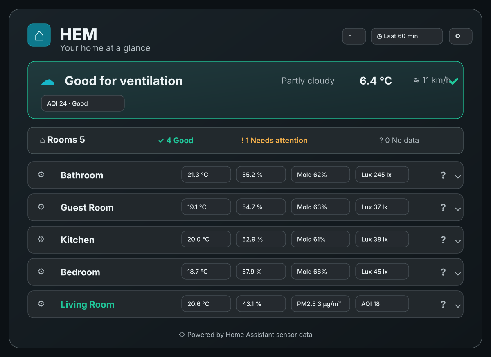
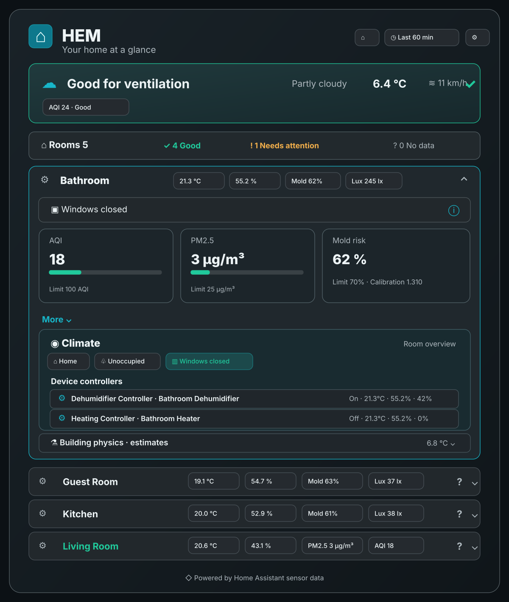

  

  

<!-- HEM-LANGUAGE-SELECTOR-START -->

  <a href="README.ar.md">العربية</a> · <a href="README.bg.md">Български</a> · <a href="README.bn.md">বাংলা</a> · <a href="README.cs.md">Čeština</a> · <a href="README.da.md">Dansk</a> · <a href="README.de.md">Deutsch</a> · <a href="README.el.md">Ελληνικά</a> · <a href="../../README.md">English</a> · <strong>Español</strong> · <a href="README.fa.md">فارسی</a> · <a href="README.fi.md">Suomi</a> · <a href="README.fr.md">Français</a> · <a href="README.he.md">עברית</a> · <a href="README.hi.md">हिन्दी</a> · <a href="README.hr.md">Hrvatski</a> · <a href="README.hu.md">Magyar</a> · <a href="README.id.md">Bahasa Indonesia</a> · <a href="README.it.md">Italiano</a> · <a href="README.ja.md">日本語</a> · <a href="README.ko.md">한국어</a> · <a href="README.nb.md">Norsk bokmål</a> · <a href="README.nl.md">Nederlands</a> · <a href="README.pl.md">Polski</a> · <a href="README.pt.md">Português</a> · <a href="README.pt-BR.md">Português (Brasil)</a> · <a href="README.ro.md">Română</a> · <a href="README.ru.md">Русский</a> · <a href="README.sk.md">Slovenčina</a> · <a href="README.sr.md">Српски</a> · <a href="README.sv.md">Svenska</a> · <a href="README.ta.md">தமிழ்</a> · <a href="README.th.md">ไทย</a> · <a href="README.tr.md">Türkçe</a> · <a href="README.uk.md">Українська</a> · <a href="README.ur.md">اردو</a> · <a href="README.vi.md">Tiếng Việt</a> · <a href="README.zh-Hans.md">简体中文</a> · <a href="README.zh-Hant.md">繁體中文</a>

<!-- HEM-LANGUAGE-SELECTOR-END -->

# HEM - Home Environment Manager

  

<strong>Controla el ambiente de toda tu casa desde una única tarjeta de Home Assistant.</strong>

**HEM te ayuda a conocer las condiciones de tu hogar y a responder a las necesidades de cada habitación.** Reúne los sensores de Home Assistant, los datos meteorológicos, la información de presencia y los equipos compatibles de climatización y tratamiento del aire. Así puedes supervisar la calidad del aire, recibir recomendaciones para ventilar, mejorar el confort y automatizar los dispositivos que elijas.

Por ejemplo, HEM puede reducir la calefacción cuando no hay nadie en casa, preparar determinadas habitaciones antes de tu regreso, usar otro objetivo de humedad mientras duermes o recomendarte abrir una ventana antes de encender un deshumidificador. También puede limitarse a **supervisar y recomendar**, sin controlar ningún dispositivo.

**Tú decides.** Cada habitación tiene sus propios ajustes. Cada aparato compatible cuenta con métodos de control, modos de funcionamiento, consignas y límites de seguridad independientes. Seleccionar un dispositivo no le da permiso automáticamente a HEM para manejarlo.

[Descubrir las funciones](#what-can-hem-do) · [Ver la interfaz](#see-hem-in-action) · [Instalar HEM](#installation) · [Primeros pasos](#getting-started) · [Guía detallada](../../docs/advanced-configuration.md)

## ¿Qué puede hacer HEM?

| Situación | Cómo puede ayudarte HEM |
| --- | --- |
| **No hay nadie en casa** | Aplica las consignas del perfil de ausencia (Away), respeta las reglas de presencia de cada habitación y evita que determinados equipos funcionen sin necesidad. |
| **Estás volviendo a casa** | Con **Preparar la llegada**, los controladores automáticos autorizados pueden usar temporalmente las consignas Home aunque todavía no haya regresado nadie. |
| **Alguien está durmiendo** | Usa objetivos Sleep, reduce el ruido de los ventiladores o mantiene apagados algunos equipos mientras todas las habitaciones ocupadas están en modo de sueño. |
| **Una habitación tiene demasiada humedad** | Compara la humedad y la estimación del riesgo de moho con los valores objetivo, aconseja ventilar o regula un deshumidificador autorizado mediante Automatic o PID. |
| **Hace calor y hay mucho sol** | Evalúa la temperatura, la luz solar, el tiempo y los contactos de ventana antes de mover persianas o toldos cuyo control hayas autorizado. |
| **El aire exterior es más favorable** | Recomienda ventilar teniendo en cuenta las necesidades de la estancia, la contaminación exterior, la temperatura, la humedad, el viento y, cuando existen, los avisos meteorológicos o datos de polen. |
| **Un radiador o una válvula termostática (TRV) deja de responder** | Muestra su estado de indisponibilidad o espera, conserva la configuración y notifica las incidencias compatibles sin dar por hecho que la batería o el relé se hayan recuperado. |

Son ejemplos, no acciones obligatorias en todas las viviendas. Las posibilidades dependen de los sensores que hayas seleccionado, de las funciones que tus equipos ofrecen realmente en Home Assistant y de las autorizaciones que configures.

## Descubre todas las funciones

### Toda la casa en un panel

La tarjeta HEM ofrece una visión general sin tener que abrir varias integraciones.

- Consulta las condiciones exteriores, la calidad del aire y las recomendaciones de ventilación.
- Compara todas las habitaciones monitorizadas: temperatura, humedad relativa, AQI, PM2.5, indicador de riesgo de moho, iluminación y otras medidas disponibles.
- Despliega cualquier habitación para consultar sus mediciones, puertas y ventanas, equipos de climatización, controladores activos, motivos de espera y estimaciones relacionadas con la física del edificio.
- Revisa el historial y las tendencias, identifica qué sensores intervienen en una media y diferencia los datos ausentes de las medidas reales.
- Agrupa las habitaciones por las plantas definidas en Home Assistant o utiliza una lista sencilla si no tienes plantas configuradas.

### Ajustes distintos para la casa, cada habitación y cada dispositivo

HEM separa las reglas generales del hogar de las decisiones que afectan a una habitación o un equipo concreto.

| Nivel | Qué puedes configurar |
| --- | --- |
| **Hogar** | Fuentes de tiempo y contaminación exterior, habitaciones supervisadas, límites generales de ventilación, presencia en casa, preparación de la llegada y canales de avisos. |
| **Habitación** | Sensores de temperatura y humedad, umbrales de calidad del aire, contactos de ventanas y puertas, reglas de presencia y sueño, objetivos de confort, ventilación y protección solar. |
| **Dispositivo** | Modos compatibles, método Automatic/Manual/PID, consignas por perfil, sensores, ajustes silenciosos, tiempos mínimos de funcionamiento, protecciones eléctricas, comportamiento ante ventanas abiertas y avisos de fallo. |

Los ajustes de la vivienda, las habitaciones y los dispositivos están agrupados y se pueden buscar en la tarjeta. Elige **Básico**, **Avanzado** o **Experto** para decidir qué ajustes se muestran. Básico incluye los controles habituales y la configuración necesaria. Avanzado añade los coeficientes PID manuales y ajustes detallados. Experto añade modelos especializados y ajustes de capacidad. Cada nivel incluye los anteriores. Puedes actualizar las fuentes disponibles cuando cambie tu instalación de Home Assistant. <!-- HEM-I18N:levels -->

### Climatización y PID, dispositivo por dispositivo

HEM puede trabajar con equipos compatibles de Home Assistant de tipo **climate**, **humidifier** y **fan**, incluidos sistemas de calefacción, refrigeración, humidificación, deshumidificación y determinados equipos de circulación o limpieza del aire.

Para **cada modo de funcionamiento realmente compatible**, elige un método de control independiente:

| Método | Qué significa |
| --- | --- |
| **Existing** | Mantener el método de control que ya utiliza el dispositivo. |
| **Automatic** | Responder a la necesidad medida, las consignas según la situación y los permisos que hayas establecido. |
| **PID** | Utilizar un control proporcional, integral y derivativo con realimentación cuando el equipo y las mediciones lo permitan. |
| **Manual** | Controlar mediante las órdenes manuales y consignas compatibles. |
| **Off** | Mantener ese controlador apagado respetando las protecciones y comprobaciones de respuesta necesarias. |

Por ejemplo, un aire acondicionado puede emplear **PID al calentar** y **Automatic al enfriar**. Un deshumidificador puede disponer de parámetros PID, objetivos y tiempos de ciclo propios. Algunos ventiladores también pueden utilizar PID si cuentan con información fiable para el tipo de control requerido.

**PID no es una forma de saltarse las protecciones.** HEM solo ofrece los métodos compatibles con el aparato, su modo físico y los datos disponibles. Entre las opciones avanzadas están la calibración y los ajustes por modo, las propuestas de adaptación, el funcionamiento silencioso y las velocidades de ventilación compatibles. Tú apruebas los cambios propuestos, salvo que actives expresamente una adaptación automática dentro de límites definidos.

### Confort cuando estás en casa, ahorro cuando estás fuera

HEM puede elegir entre los perfiles **Comfort, Home, Away, Sleep y Eco** según la situación del hogar, la información de cada estancia y tus preferencias.

- **Home y Away:** Utiliza objetivos de calefacción, refrigeración y humedad distintos según la presencia confirmada en la vivienda.
- **Presencia en la habitación:** Un dispositivo compatible puede funcionar cuando hace falta, solo cuando la estancia está ocupada o solo cuando está vacía.
- **Sleep:** Aplica consignas nocturnas y ventilación más silenciosa. Puedes hacer que determinados equipos permanezcan apagados cuando todas las habitaciones ocupadas están en modo de sueño.
- **Eco:** Usa consignas de ahorro donde las hayas configurado. Una puerta interior cerrada puede formar parte de una regla Eco protegida si se confirma que la habitación está vacía y se cumplen otras condiciones. Cerrar una puerta, por sí solo, no demuestra que el espacio esté aislado.
- **Preparación del despertar:** Según la próxima alarma configurada, HEM puede salir antes del modo Sleep automático para dar tiempo a que respondan los equipos adecuados.

Si la presencia, la disponibilidad de un aparato o cualquier otra información necesaria es incierta, HEM no presupone que sea seguro iniciar el control automático.

### Prepara tu hogar antes de volver

**Preparar la llegada** es una acción temporal para una vivienda cuya ausencia (Away) está confirmada. Puedes activarla desde la cabecera de la tarjeta o desde el dispositivo Home de HEM.

Durante ese periodo, HEM aplica las **consignas Home** a los controladores Automatic/PID adecuados. Así, las habitaciones seleccionadas pueden empezar a calentarse, enfriarse o ajustar su humedad antes de tu regreso. También puede permitir temporalmente un controlador que normalmente exige presencia en su habitación, **pero solo si ya tiene permiso para manejar físicamente ese dispositivo**.

Preparar la llegada no significa encenderlo todo. Debe existir una necesidad real, datos de sensores válidos y autorización. Siguen vigentes las restricciones de ventanas, los tiempos mínimos ON/OFF y las protecciones de cada aparato. La acción finaliza cuando llega alguien, la cancelas o vence el plazo. Reiniciar Home Assistant no reinicia ese plazo desde cero.

### Consejos de ventilación, ventanas, puertas y sombreado

HEM compara **lo que necesita una habitación** con **la utilidad del aire exterior para cubrir esa necesidad**.

- Recomienda abrir o cerrar ventanas según las mediciones interiores, la humedad y la contaminación exteriores, la temperatura, el viento, los avisos meteorológicos y, opcionalmente, los datos de polen.
- El índice AQI es opcional. Si no se ha configurado la escala del proveedor, HEM indica que faltan datos; esto por sí solo no impide ventilar ni justifica cerrar una ventana. Se siguen teniendo en cuenta las mediciones válidas de contaminantes y los valores AQI realmente peligrosos interpretados con la escala correcta. <!-- HEM-I18N:aqi -->
- Usa los contactos de puertas y ventanas elegidos para interpretar las condiciones de la habitación sin asumir que un contacto de estado desconocido está cerrado.
- Puedes incluir puertas de balcón o terraza con la clase de sensor binario de Home Assistant `door` u `opening` como **entradas de ventana**. Aparecen en el selector de ventanas de la habitación, pero **nunca se seleccionan de antemano**. La supervisión habitual de puertas sigue siendo independiente. <!-- HEM-I18N:balcony -->
- Si lo deseas, puede sugerirte abrir una ventana antes de activar automáticamente un equipo compatible y retomar el control normal tras el tiempo de espera configurado cuando proceda.
- La información de las puertas ayuda a comprender la separación entre estancias, emitir advertencias de ventilación y aplicar reglas Eco opcionales con comprobaciones de seguridad.
- Permite controlar persianas, estores y toldos autorizados a partir de datos adecuados de ventanas, temperatura, meteorología, elevación solar y, opcionalmente, luminosidad.

No necesitas ventanas motorizadas para recibir consejos de ventilación. **HEM no abre una ventana por sí mismo** simplemente porque ventilar pueda resultar útil.

### Humedad, riesgo estimado de moho y calidad del aire

HEM reúne mediciones compatibles como **temperatura, humedad, CO₂, partículas en suspensión, COV, AQI y luminosidad**. Los valores disponibles dependen de los sensores conectados a tu Home Assistant.

Su **indicador de riesgo de moho** estima las condiciones de humedad en una superficie fría a partir de las temperaturas interior y exterior y de una medición de calibración. Bien configurado, puede influir en la consigna efectiva de un controlador automático de humedad compatible.

**Es una estimación, no un detector de moho ni de esporas.** Los datos ausentes o desactualizados no justifican el envío de nuevas órdenes basadas en ese indicador.

### Avisos, diagnóstico y protecciones

Puedes recibir recomendaciones y alertas mediante notificaciones de Home Assistant, TTS/reproductores multimedia o **Announcement Hub**. Opcionalmente, la IA puede mejorar la redacción de los mensajes. **Las decisiones que afectan físicamente a los equipos siguen reglas deterministas** y no las toma la IA.

HEM también ofrece protecciones y diagnóstico por dispositivo:

- Tiempos mínimos encendido/apagado, duración máxima de funcionamiento y control de interruptores externos de alimentación compatibles.
- Restricciones por ventanas y presencia, respeto de intervenciones manuales y comprobación de la respuesta a las órdenes nativas.
- Avisos por fallos o indisponibilidad con ajustes individuales para cada equipo.
- Vigilancia opcional tras una orden OFF cuando existen indicios de que la calefacción sigue funcionando, con verificaciones prudentes e intentos de recuperación limitados.
- Motivos de espera, estado de funcionamiento y disponibilidad de fuentes claramente indicados para que puedas investigar antes de permitir más automatizaciones.

**Las protecciones siguen activas aunque deshabilites los avisos.** Que una orden se haya enviado correctamente no demuestra que el aparato la haya ejecutado físicamente.

## HEM en acción

Las siguientes ilustraciones están en inglés y muestran habitaciones y datos de ejemplo. Sirven para explicar la interfaz y no representan lecturas reales de una vivienda determinada.

### Tu casa de un vistazo

Consulta las recomendaciones de ventilación, el tiempo y el estado de todas las habitaciones supervisadas en una única tarjeta.

  

### Detalles de una habitación

Examina la calidad del aire, el indicador de moho, la presencia, las ventanas, los controladores y los motivos de cada decisión.

  

### Ajustes del hogar

Configura las fuentes exteriores, la presencia general, las habitaciones, los límites de ventilación, la preparación de llegada y las notificaciones.

  

### Ajustes de las habitaciones

Elige los sensores, objetivos, reglas de presencia, puertas, ventanas, ventilación, persianas y protecciones apropiados para cada habitación.

  

### Ajustes de los dispositivos

Personaliza por separado los métodos de control, el PID, el funcionamiento silencioso, los tiempos y los avisos de fallos de cada equipo.

  

## Primeros pasos

1. **Organiza las habitaciones.** Crea o revisa las Áreas (Areas) de Home Assistant y asigna los sensores y aparatos correspondientes a cada una.
2. **Elige qué quieres supervisar.** Añade HEM, selecciona las habitaciones y revisa las fuentes sugeridas de temperatura, humedad, ventanas, calidad del aire y dispositivos. Puedes dejar sin configurar los grupos que no utilices.
3. **Configura la información común.** Elige las fuentes meteorológicas y de calidad del aire exterior, los datos de presencia en casa y los destinos de avisos que necesites.
4. **Añade la tarjeta.** Abre un panel en modo edición y añade **Home Environment Manager**. Empieza supervisando los valores de las habitaciones y las recomendaciones de ventilación.
5. **Autoriza el control solo donde sea útil.** Abre una habitación, elige un equipo compatible, revisa su controlador y selecciona expresamente Automatic o PID en los modos que HEM podrá manejar.

**No necesitas un dispositivo inteligente en cada habitación.** Empieza con los sensores que ya tienes y activa el control automático de manera gradual, equipo por equipo.

### Añadir la tarjeta manualmente

La integración suele registrar su propia tarjeta Lovelace. Si prefieres utilizar YAML:

~~~yaml
type: custom:home-environment-manager-card
~~~

Si tienes varios sensores de recomendaciones HEM en Home Assistant, quizá debas indicar expresamente la **entidad (entity)** correspondiente:

~~~yaml
type: custom:home-environment-manager-card
entity: sensor.your_hem_recommendation_sensor
~~~

Si necesitas más información sobre sensores, perfiles, PID, reglas de ventanas, preparación de llegada, calibración del riesgo de moho, sombreado y avisos, consulta la [guía de configuración detallada](../../docs/advanced-configuration.md).

## Instalación

### Con HACS (Home Assistant Community Store)

1. Abre **HACS** en Home Assistant.
2. Añade **https://github.com/Chreece/HA-Home-Environment-Manager** como **repositorio personalizado (custom repository)** en la categoría **Integration**, si todavía no aparece.
3. Busca **Home Environment Manager** e instálalo.
4. Reinicia **Home Assistant** para cargar la integración.
5. Ve a **Ajustes → Dispositivos y servicios → Añadir integración**, busca **Home Environment Manager** y completa la configuración.

### Instalación manual

Copia la carpeta **custom_components/environment_manager** del repositorio dentro del directorio **custom_components** correspondiente de tu configuración de Home Assistant, conservando el nombre **environment_manager**. Reinicia Home Assistant y añade la integración desde **Ajustes → Dispositivos y servicios**.

En futuras actualizaciones, conserva la entrada de HEM que ya tengas y sus ajustes. Si la tarjeta no cambia de aspecto enseguida, actualiza la página del panel en el navegador.

## Preguntas frecuentes

**¿Puedo usar HEM sin permitirle controlar mis dispositivos?**

Sí. La supervisión, las mediciones, los consejos de ventilación, el historial y muchos indicadores ambientales funcionan sin activar el control de equipos.

**¿HEM controla automáticamente todos los dispositivos que detecta?**

No. Tú seleccionas qué equipos quieres gestionar y autorizas los métodos de control de los modos compatibles. Las funciones disponibles también dependen de las capacidades reales de cada aparato y de los sensores.

**¿Todos los equipos admiten PID?**

No. PID solo está disponible para **modos compatibles** de calefacción, refrigeración, humedad o ventilación cuando existen las capacidades y las mediciones necesarias. HEM no añade un PID ficticio a los modos que no lo soportan.

**¿Puedo establecer reglas distintas en cada habitación?**

Sí. La presencia, el sueño, las fuentes, las consignas y algunas opciones de seguridad pueden variar según la habitación. Cada equipo conserva sus propios ajustes de funcionamiento y protección.

**¿Puede HEM preparar la casa mientras estoy fuera?**

Sí. **Preparar la llegada** permite temporalmente que los controladores automáticos adecuados y previamente autorizados utilicen las consignas Home. No anula las protecciones ni garantiza que se alcancen los objetivos.

**¿Una recomendación para ventilar abre mis ventanas automáticamente?**

No. Solo indica cuándo puede convenir ventilar. El movimiento motorizado es una función independiente y opcional para persianas y protecciones solares compatibles, con sus propias comprobaciones de seguridad.

**¿Qué ocurre si un sensor o dispositivo deja de estar disponible?**

HEM diferencia la falta de datos de las mediciones reales, conserva cuando es posible la configuración de los controladores y muestra los motivos de espera y los diagnósticos. Para cualquier control automático siguen siendo necesarios datos actuales válidos y la autorización correspondiente.

## Ayuda y solución de problemas

Si algo no funciona como esperabas, revisa el **Motivo (Reason)**, los **Diagnósticos (Diagnostics)**, la disponibilidad de fuentes y el método de control de la habitación o dispositivo afectado. La [guía de configuración detallada](../../docs/advanced-configuration.md) explica las esperas habituales, las reglas de presencia, los requisitos de PID, las ventanas y los problemas de respuesta de los equipos.

Si puedes reproducir un fallo, [abre una incidencia en GitHub](https://github.com/Chreece/HA-Home-Environment-Manager/issues). Indica el comportamiento esperado, el observado, los ajustes relevantes y los pasos necesarios para reproducirlo. Elimina los datos personales de registros e imágenes.

Se agradecen las contribuciones y las mejoras. Consulta [CONTRIBUTING.md](../../CONTRIBUTING.md).

## Apoyo y licencia

Si HEM te resulta útil, puedes [apoyar a Chreece en Ko-fi](https://ko-fi.com/chreece).

Distribuido bajo la [licencia MIT](../../LICENSE).
