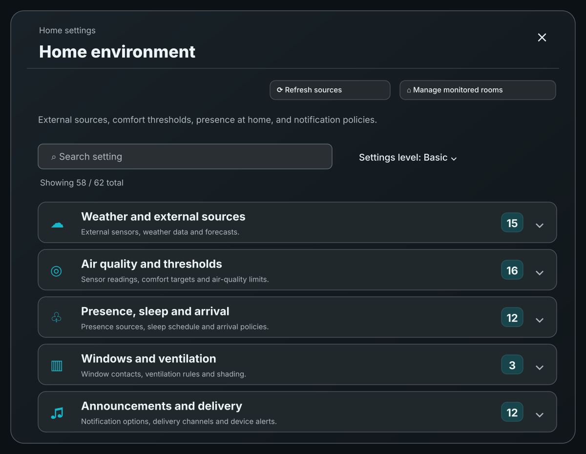
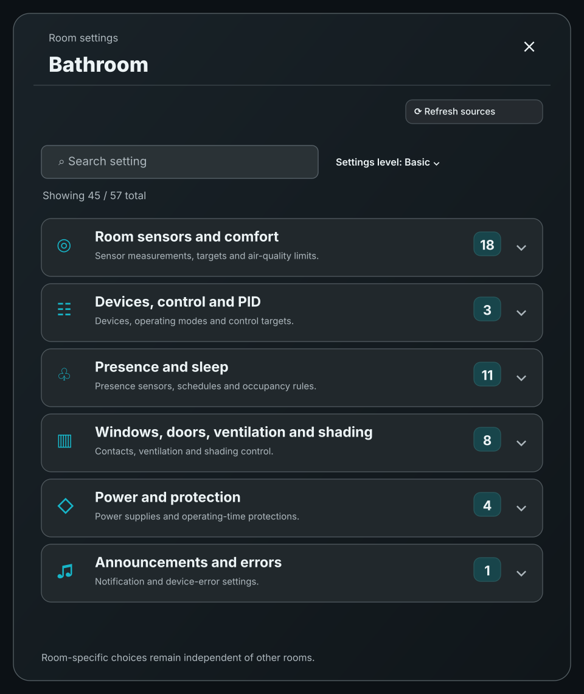
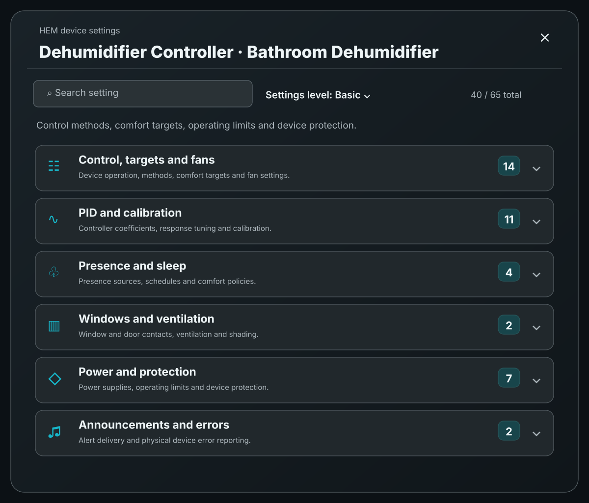

  

  

<!-- HEM-LANGUAGE-SELECTOR-START -->

  <a href="README.ar.md">العربية</a> · <a href="README.bg.md">Български</a> · <a href="README.bn.md">বাংলা</a> · <a href="README.cs.md">Čeština</a> · <a href="README.da.md">Dansk</a> · <a href="README.de.md">Deutsch</a> · <a href="README.el.md">Ελληνικά</a> · <a href="../../README.md">English</a> · <a href="README.es.md">Español</a> · <a href="README.fa.md">فارسی</a> · <a href="README.fi.md">Suomi</a> · <a href="README.fr.md">Français</a> · <a href="README.he.md">עברית</a> · <a href="README.hi.md">हिन्दी</a> · <a href="README.hr.md">Hrvatski</a> · <a href="README.hu.md">Magyar</a> · <a href="README.id.md">Bahasa Indonesia</a> · <strong>Italiano</strong> · <a href="README.ja.md">日本語</a> · <a href="README.ko.md">한국어</a> · <a href="README.nb.md">Norsk bokmål</a> · <a href="README.nl.md">Nederlands</a> · <a href="README.pl.md">Polski</a> · <a href="README.pt.md">Português</a> · <a href="README.pt-BR.md">Português (Brasil)</a> · <a href="README.ro.md">Română</a> · <a href="README.ru.md">Русский</a> · <a href="README.sk.md">Slovenčina</a> · <a href="README.sr.md">Српски</a> · <a href="README.sv.md">Svenska</a> · <a href="README.ta.md">தமிழ்</a> · <a href="README.th.md">ไทย</a> · <a href="README.tr.md">Türkçe</a> · <a href="README.uk.md">Українська</a> · <a href="README.ur.md">اردو</a> · <a href="README.vi.md">Tiếng Việt</a> · <a href="README.zh-Hans.md">简体中文</a> · <a href="README.zh-Hant.md">繁體中文</a>

<!-- HEM-LANGUAGE-SELECTOR-END -->

# HEM - Home Environment Manager

<!-- HEM-TRANSLATION-UNREVIEWED-START -->
> ⚠️ **Traduzione automatica non revisionata.** L’accuratezza linguistica e tecnica di questa pagina non è stata verificata e alcune descrizioni potrebbero essere errate. Per l’installazione, il controllo dei dispositivi e le istruzioni di sicurezza, consulta il <a href="../../README.md">README in inglese</a>.
<!-- HEM-TRANSLATION-UNREVIEWED-END -->

  

<strong>L'intero ambiente della tua casa, in una sola Home Assistant - La carta.</strong>

[Esempi per stanza](#what-can-hem-do) · [Funzionalità](#explore-the-features) · [Schermate](#see-hem-in-action) · [Installazione](#installation) · [Primi passi](#getting-started) · [Domande frequenti](#common-questions) · [Risoluzione dei problemi](#help-and-troubleshooting) · [Sostegno e licenza](#support-and-license)

## In breve

HEM usa i sensori già presenti in Home Assistant per mostrare temperatura, umidità e qualità dell’aria in ogni stanza. Confronta le condizioni interne ed esterne per suggerire quando aprire o chiudere le finestre. Puoi limitarti ai consigli oppure affidargli il controllo di riscaldamento, climatizzatori, ventilatori e deumidificatori a tua scelta, con obiettivi diversi quando sei a casa, fuori o dormi.

  

[Guida dettagliata](../../docs/advanced-configuration.md) · [Tutte le impostazioni (in inglese)](../../docs/settings-reference.md)

## Che cosa può HEM - Non è vero?

| La tua situazione | Come HEM può aiutare |
| --- | --- |
| **La casa è vuota .** | Passare agli obiettivi Away, rispettare le regole di presenza di ciascuna stanza e evitare di eseguire inutilmente le attrezzature selezionate. |
| **Sei in viaggio di ritorno.** | Pressione **Preparatevi all'arrivo** per utilizzare temporaneamente gli obiettivi di comfort domestico per i controller automatici idonei, anche se tutti sono ancora lontani. |
| **Qualcuno sta dormendo .** | Utilizzare gli obiettivi del sonno, ridurre il rumore dei ventilatori o spegnere i dispositivi selezionati mentre ogni stanza occupata dorme. |
| **Una stanza è umida .** | Confrontare l'indicazione dell'umidità e della muffa con gli obiettivi, suggerire un'ariazione utile o utilizzare un deumidificatore autorizzato utilizzando PID controllo. |
| **E' caldo e soleggiato** | Valutare la temperatura della stanza, la luce solare, il tempo e i contatti con le finestre collegate prima di spostare le tonalità scelte. |
| **L'aria esterna sembra migliore .** | Si raccomanda ventilazione utilizzando la domanda interna, l'inquinamento esterno, la temperatura, l'umidità, il vento e i consigli meteorologici relativi al polline disponibile. |
| **Un riscaldatore o TRV smette di rispondere** | Indicare lo stato non disponibile o in attesa, mantenere il controller configurato e segnalare i guasti del dispositivo supportato senza presumere che una batteria o un relè si siano recuperati. |

Questi sono esempi, non azioni che HEM I risultati dipendono dai sensori selezionati, dal livello effettivo del dispositivo. Home Assistant le funzionalità e le impostazioni di accettazione.

## Esplora le caratteristiche

### Un pannello di controllo completo

Il HEM la carta ti dà una utile panoramica senza aprire diverse integrazioni.

- Vedere le condizioni all'aperto, la qualità dell'aria e se è consigliabile ventilare.
- Confrontare tutte le stanze monitorate in un colpo d'occhio: temperatura, umidità relativa, AQI, PM2.5, indicazione di muffa, luce e altre letture supportate.
- Espandi qualsiasi spazio per le misure dettagliate, le informazioni sulle finestre e le porte, lo stato climatico, i controllatori attivi, i motivi di attesa e le stime di fisica dell'edificio.
- Visualizzare le storie e le tendenze, vedere quali sensori hanno contribuito alla media e distinguere le letture mancanti dai valori misurati.
- Camere di gruppo per numero effettivo Home Assistant Se non avete piani, utilizzate una semplice lista di stanze.

### Diversi impostazioni per la casa, ogni stanza e ogni dispositivo

HEM mantenere le politiche condivise separate dalle decisioni locali.

| Livello delle impostazioni | Cosa puoi configurare |
| --- | --- |
| **Casa** | Fonti meteorologiche e di inquinamento all'aperto, stanze monitorate, limiti di ventilazione globali, presenza delle famiglie, preparazione dell'arrivo e consegna degli annunci. |
| **Camera** | Fonti di temperatura e umidità interne, soglie di qualità dell'aria, contatti tra finestre e porte, comportamento di sonno e di occupazione, obiettivi di comfort specifici per la stanza, ventilazione e ombra. |
| **Dispositivo individuale** | Le sue modalità di controllo disponibili, Automatica/Manuale/PID metodo, obiettivi per profilo, sensori, impostazioni di ventilatore tranquillo, tempi minimi di funzionamento, protezioni di alimentazione, comportamento delle finestre e notifiche di errore del dispositivo. |

Le impostazioni di casa, stanze e dispositivi sono raggruppate nella scheda e possono essere cercate. Scegli **Base**, **Avanzato** o **Esperto** per decidere quali impostazioni visualizzare. Base comprende i comandi quotidiani e la configurazione necessaria. Avanzato aggiunge la regolazione manuale dei coefficienti PID e le impostazioni dettagliate. Esperto aggiunge modelli specialistici e regolazioni della capacità. Ogni livello include quelli precedenti. Puoi aggiornare le fonti disponibili quando cambia la configurazione di Home Assistant. <!-- HEM-I18N:levels -->

### Controllo del clima e PID, dispositivo per dispositivo

HEM può funzionare con compatibili Home Assistant **clima**, **Ummidificatore** e **ventilatore** dispositivi, compresi il riscaldamento, il raffreddamento, la deumidificazione, l'umidificazione e il supporto per la circolazione dell'aria o per la pulizia dell'aria.

Per ciascuna **modalità di funzionamento fisica supportata**, scegliere autonomamente il metodo di controllo:

| Metodo | Cosa significa? |
| --- | --- |
| **Esistenti** | Lasciare funzionare con il percorso del controllore esistente. |
| **Automatica** | Seguire HEMLa domanda misurata, gli obiettivi e le autorizzazioni basati sulla situazione. |
| **PID** | Utilizzare un controllo proporzionale, integrale e derivato basato su feedback quando il dispositivo e la misura lo supportano. |
| **Manuale** | Controllo attraverso richieste e obiettivi esplicitamente supportati. |
| **- Spegni .** | Tenete spento quel controller, soggetto alle esigenze di protezione fisica e di feedback. |

Ad esempio, un condizionatore d'aria può utilizzare **PID per il riscaldamento** e **Automatica per il raffreddamento**Un deumidificatore può avere il suo PID Il sistema di calibrazione, obiettivi e tempi di ciclo. PID quando sono disponibili feedback adeguati e controlli specifici per lo scopo.

PID è **non** una sovrastanza universale: HEM Le opzioni avanzate includono la regolazione e la calibrazione per modalità, le regolazioni suggerite/adattive, il funzionamento silenzioso e le impostazioni dei ventilatori in fase supportate.

### Comodo quando sei a casa, economico quando sei via

HEM può scegliere tra **Conforto, casa, via, sonno e ambiente** obiettivi basati sulla situazione della famiglia, sulle prove della stanza e sulle tue scelte esplicite.

- **A casa e via:** Utilizzare obiettivi di riscaldamento, raffreddamento e umidità diversi a seconda della presenza verificata in casa.
- **Presenza in camera:** Eseguire un dispositivo idoneo sempre che c'è domanda, solo quando la sua stanza è occupata, o solo quando la stanza è vuota.
- **Dormire:** Applicare obiettivi notturni e comportamenti più silenziosi del ventilatore.
- **Eco:** Utilizzare obiettivi economici quando configurati. Una porta interna chiusa può partecipare a una politica ecologica protetta quando la stanza è verificata vuota e altre condizioni sono soddisfatte; una porta chiusa da sola non dimostra che la stanza è isolata.
- **Preparazione al risveglio:** Utilizzare una sorgente di allarme successiva configurata per lasciare il sonno automatico prima dell'allarme e dare tempo ai dispositivi idonei per rispondere.

Se l'occupazione, la disponibilità del dispositivo o altre prove richieste sono incerte, HEM non assume semplicemente che sia sicuro avviare un dispositivo automatico.

### Prepara il tuo ambiente prima di arrivare

**Preparatevi all'arrivo** È un'azione tempestiva per una casa di partenza confermata. HEME' il dispositivo di casa.

HEM applica temporaneamente la configurazione **Obiettivi per l'abitazione** per l'Automatic/PID controller in modo che le stanze possano iniziare a riscaldare, raffreddare o regolare l'umidità prima del ritorno. **solo quando ha già il permesso di controllo fisico necessario**.

La preparazione non è un comando per accendere tutto. I dispositivi hanno ancora bisogno di una domanda autentica, sensori validi e autorizzazione, e devono rispettare le finestre, tempi minimi di ON/OFF e le proprie protezioni. L'azione termina quando qualcuno arriva, lo annulla o il timer configurato scade. Home Assistant riavvio non ricomincia il timer completo.

### Consigli di ventilazione, finestre, porte e ombra

HEM confronto **che cosa serve una stanza** con **se l'aria esterna può aiutare**.

- Si consiglia di aprire o chiudere le finestre utilizzando le misurazioni attuali di interni, di umidità esterna, di inquinamento, di temperatura, di vento, di allarmi meteorologici e di contesti di polline opzionali.
- L’indice AQI è facoltativo. Se la scala del fornitore non è configurata, HEM segnala dati incompleti: questo, da solo, non impedisce di arieggiare e non è un motivo per chiudere una finestra. Restano valide le misurazioni degli inquinanti e le letture AQI realmente pericolose interpretate con la scala corretta. <!-- HEM-I18N:aqi -->
- Utilizzare i contatti delle finestre e delle porte selezionati per spiegare le condizioni della stanza e evitare di trattare un contatto sconosciuto come chiuso.
- Puoi includere le porte di balconi o terrazze con classe di sensore binario Home Assistant `door` o `opening` come **ingressi finestra**. Compaiono nel selettore delle finestre della stanza, ma **non vengono mai preselezionate**. Il normale monitoraggio delle porte rimane indipendente. <!-- HEM-I18N:balcony -->
- In alternativa, chiedi di provare ad aprire una finestra prima di avviare un apparecchio automatico supportato, quindi continua il controllo normale dopo che la risposta configurata aspetta se necessario.
- Utilizzare le informazioni sulle porte per la consapevolezza dei confini delle stanze, le precauzioni di ventilazione e il comportamento ecologico facoltativo.
- Gestione dei persiani, dei persiani e delle sfumature utilizzando la finestra, la temperatura, il tempo, l'elevazione solare e le prove di illuminazione opzionali.

HEM Il sistema di ventilazione non può aprire una finestra da solo solo perché l'ariazione aiuta.

### Umidità, indicazione della muffa e qualità dell'aria

HEM combina letture supportate come: **temperatura, umidità, CO2, particelle, COV, AQI e illuminazione** Le misurazioni disponibili dipendono da ciò che la vostra Home Assistant l'installazione fornisce.

Il suo **indicazione della muffa** la misurazione dell'umidità in una superficie fredda a partire da temperature ambientali ed esterne e da una misurazione di calibrazione.

**L'indicazione della muffa è una stima, non un rilevatore di muffe o spore.** La mancanza o la disuso dei dati dei sensori non può giustificare un nuovo comando del dispositivo basato su un modello.

### Annunci, diagnosi e protezione

È possibile inviare raccomandazioni e avvisi pertinenti attraverso Home Assistant le notifiche, i lettori TTS/media o **Centro di annuncio**L'intelligenza artificiale può cambiare il modo in cui un messaggio viene espresso; HEMLe decisioni di controllo fisico restano deterministe.

HEM comprende anche le protezioni e la diagnostica specifiche per il dispositivo:

- Durate minima di accensione e di spegnimento, impostazioni massime di tempo di funzionamento e manovra di commutatore di alimentazione esterno supportato.
- Restrizioni alle finestre e all'occupazione, manuale manovra e controlli di riconoscimento nativi.
- Segnalazione di errori e di dispositivi non disponibili, con una scelta di comportamento di notifica per ciascun dispositivo.
- Per ogni dispositivo puoi verificare se il riscaldamento, il raffrescamento, la deumidificazione o l’umidificazione sembrano proseguire dopo lo spegnimento. Scegli il solo monitoraggio o consenti fino a due ulteriori comandi di spegnimento.
- Clari motivi di attesa, stato operativo attuale e disponibilità delle fonti, in modo da poter indagare prima di consentire un maggiore controllo.

**I limiti di sicurezza restano in vigore anche quando l'allarme è disattivato.** HEM non tratta mai una spedizione di comando di successo come prova che un apparecchio abbia reagito fisicamente.

## Vedi ? HEM in azione

Queste illustrazioni in lingua inglese utilizzano campioni di camere e misure, che mostrano l'interfaccia piuttosto che mostrare dati in diretta da una casa particolare.

### Home in un colpo d'occhio

Ottenere consigli di ventilazione, condizioni meteorologiche e lo stato di ogni stanza monitorata in una singola scheda.

  

### Espandi una stanza per i dettagli

Controllare la qualità dell'aria, l'indicazione della muffa, la presenza, lo stato delle finestre, i controlli climatici e le spiegazioni di ciascuna decisione.

  

### Impostazioni per la casa

Gestire le fonti esterne, la presenza in tutta la casa, le stanze monitorate, i limiti di ventilazione, la preparazione e le notifiche.

  

### Impostazioni delle stanze

Scegliete ciò che è importante per ogni stanza: i propri sensori, gli obiettivi, l'occupazione, le porte, le finestre, la ventilazione, l'ombra e le garanzie.

  

### Impostazioni del dispositivo

Armonizzazione fine di un dispositivo senza modificare gli altri, compresi i metodi di controllo supportati, PID, operazione silenziosa, tempistica e segnalazione di errori.

  

## Iniziando

1. **Organizzate le vostre stanze.** In Home Assistant, creare o controllare le vostre aree e assegnare i sensori e i dispositivi appropriati a ciascuno di essi.
2. **Scegli cosa controllare.** Aggiungere HEM, selezionare le stanze che ti interessano e rivedere la temperatura, l'umidità, la finestra, la qualità dell'aria e le fonti di dispositivo suggerite.
3. **Configurare le informazioni condivise.** Selezionare le fonti meteorologiche disponibili all'aperto/qualità dell'aria, le prove di occupazione delle famiglie e le destinazioni di annuncio che desiderate.
4. **Home Environment Manager** Apri un pannello di controllo in modalità modifica e aggiungi il **Responsabile dell'ambiente** Inizia con il monitoraggio della stanza, le letture e i consigli di ventilazione.
5. **Abilitare il controllo solo quando utile.** Aprire una stanza, scegliere un apparecchio supportato, rivedere il suo controller e selezionare esplicitamente Automatic o PID per le modalità che si desidera HEM operare.

Lo sai . **non** Inizia con i sensori che hai e introduce il controllo automatico, un dispositivo alla volta.

### Aggiungere la scheda manualmente

L'integrazione registra normalmente la propria carta Lovelace.

~~~yaml
type: custom:home-environment-manager-card
~~~

Se il tuo Home Assistant l'installazione ha più di una HEM il sensore di raccomandazione, potrebbe essere necessario impostare il sensore appropriato **entità** esplicitamente:

~~~yaml
type: custom:home-environment-manager-card
entity: sensor.your_hem_recommendation_sensor
~~~

Per le istruzioni passo dopo passo sulle fonti, i profili, PID le impostazioni, le politiche delle finestre, la preparazione, la calibrazione dei muffe, l'ombrario solare e la consegna degli annunci, utilizzare il [guida dettagliata di configurazione](../../docs/advanced-configuration.md).

## Installazione

### HACS / Home Assistant Magazzino comunitario

1. Apri **HACS** in Home Assistant.
2. Aggiungere **https://github.com/Chreece/HA-Home-Environment-Manager** come un **archivio personalizzato** nel **Integrazione** categoria se non è già elencata.
3. Trova **Home Environment Manager** e installatelo.
4. Ripristino **Home Assistant** per caricare l'integrazione.
5. Vai a **Impostazioni → Dispositivi e servizi → Aggiungere integrazione**, ricerca per **Home Environment Manager** e completare l'impostazione.

### Installazione manuale

Copia del deposito **custom_components/environment_manager** cartella nella corrispondenza **custom_components** il tuo directory Home Assistant configurazione, mantenendo il nome della directory **environment_manager**- Riprendi . Home Assistant l'integrazione attraverso **Impostazioni → Dispositivi e servizi**.

Per le successive modifiche di installazione, mantenere le HEM inserimento e impostazioni di integrazione. ricaricare il pannello di controllo nel browser se l'aspetto della scheda non si aggiorna immediatamente.

## Domande comuni

**Posso usarla ? HEM senza dargli il controllo dei miei dispositivi?**

Il monitoraggio, le misure, i consigli di ventilazione, la storia e molte indicazioni ambientali funzionano senza che il dispositivo sia attivato.

**- Will. HEM controlla automaticamente ogni dispositivo che scopre?**

No. Si selezionano i dispositivi fisici che si desidera gestire e si sceglie esplicitamente il metodo di controllo per le modalità supportate.

**Ogni apparecchio supporta PID?**

- No, no, no, no. HEM supporti PID per **ammissibili** percorsi di riscaldamento, raffreddamento, umidità o controllo dei ventilatori quando l'apparecchio e le misure selezionate forniscono le capacità e il feedback necessari. PID controllo.

**Posso dare regole diverse a ogni stanza?**

Le condizioni di occupazione, il comportamento del sonno, le fonti, gli obiettivi e alcune preferenze di sicurezza possono differire in base alle stanze, mentre ogni dispositivo fisico ha le proprie impostazioni di funzionamento e di protezione.

**Può HEM Preparare la mia casa mentre sono via?**

- Sì, è vero. **Preparatevi all'arrivo** Il sistema di controllo automatico, che è già autorizzato, consente temporaneamente ai controllatori automatici di utilizzare gli obiettivi domestici per un periodo di tempo limitato.

**Una raccomandazione per la ventilazione mi apre le finestre?**

Il movimento automatico è una caratteristica separata, opt-in per le ombre o coperture a supporto idoneo, soggetta ai propri controlli di sicurezza.

**E se un sensore o un dispositivo non fosse disponibile?**

HEM il controllo automatico richiede ancora un'autorità e prove correnti valide.

## Aiuto e risoluzione dei problemi

Se qualcosa sembra sbagliato, controlla la stanza o il controller **La ragione**, **Diagnostiche**, la disponibilità della fonte e il metodo di controllo corrente. [guida dettagliata di configurazione](../../docs/advanced-configuration.md) copre gli stati di attesa comuni, le politiche di presenza, PID l'ammissibilità, le finestre e la risoluzione dei problemi di risposta del dispositivo.

Per un problema riproducibile, [aprire un GitHub La questione](https://github.com/Chreece/HA-Home-Environment-Manager/issues) con il comportamento atteso, il comportamento effettivo, le impostazioni della stanza/dispositivo pertinenti e i passaggi da riprodurre.

I contributi e i miglioramenti sono benvenuti. [Contributi.md](../../CONTRIBUTING.md).

## Supporto e licenza

Se HEM È utile per te, puoi [sostegno alla Grecia sul Ko-fi](https://ko-fi.com/chreece).

Distribuito in base al [Licenza MIT](../../LICENSE).
