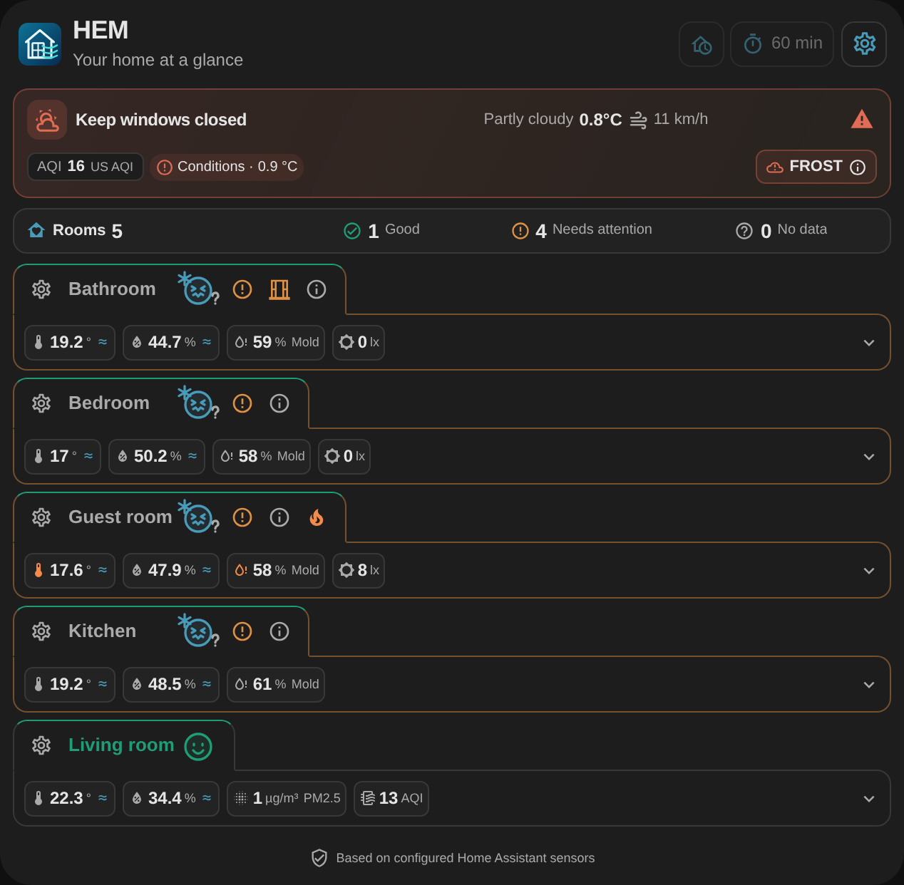

  

  

<!-- HEM-LANGUAGE-SELECTOR-START -->

  <a href="README.ar.md">العربية</a> · <a href="README.bg.md">Български</a> · <a href="README.bn.md">বাংলা</a> · <a href="README.cs.md">Čeština</a> · <a href="README.da.md">Dansk</a> · <a href="README.de.md">Deutsch</a> · <a href="README.el.md">Ελληνικά</a> · <a href="../../README.md">English</a> · <a href="README.es.md">Español</a> · <a href="README.fa.md">فارسی</a> · <a href="README.fi.md">Suomi</a> · <a href="README.fr.md">Français</a> · <a href="README.he.md">עברית</a> · <a href="README.hi.md">हिन्दी</a> · <a href="README.hr.md">Hrvatski</a> · <a href="README.hu.md">Magyar</a> · <a href="README.id.md">Bahasa Indonesia</a> · <a href="README.it.md">Italiano</a> · <a href="README.ja.md">日本語</a> · <a href="README.ko.md">한국어</a> · <a href="README.nb.md">Norsk bokmål</a> · <a href="README.nl.md">Nederlands</a> · <strong>Polski</strong> · <a href="README.pt.md">Português</a> · <a href="README.pt-BR.md">Português (Brasil)</a> · <a href="README.ro.md">Română</a> · <a href="README.ru.md">Русский</a> · <a href="README.sk.md">Slovenčina</a> · <a href="README.sr.md">Српски</a> · <a href="README.sv.md">Svenska</a> · <a href="README.ta.md">தமிழ்</a> · <a href="README.th.md">ไทย</a> · <a href="README.tr.md">Türkçe</a> · <a href="README.uk.md">Українська</a> · <a href="README.ur.md">اردو</a> · <a href="README.vi.md">Tiếng Việt</a> · <a href="README.zh-Hans.md">简体中文</a> · <a href="README.zh-Hant.md">繁體中文</a>

<!-- HEM-LANGUAGE-SELECTOR-END -->

# HEM - Home Environment Manager

<!-- HEM-TRANSLATION-UNREVIEWED-START -->
> ⚠️ **Niezweryfikowane tłumaczenie maszynowe.** Poprawność językowa i techniczna tej strony nie została sprawdzona, a niektóre opisy mogą być błędne. Instrukcje instalacji, sterowania urządzeniami i bezpieczeństwa znajdują się w <a href="../../README.md">angielskim pliku README</a>.
<!-- HEM-TRANSLATION-UNREVIEWED-END -->

  

<strong>Całe środowisko w domu, w jednym Home Assistant Karta.</strong>

[Przykłady dla pomieszczeń](#what-can-hem-do) · [Funkcje](#explore-the-features) · [Zrzuty ekranu](#see-hem-in-action) · [Instalacja](#installation) · [Pierwsze kroki](#getting-started) · [Częste pytania](#common-questions) · [Rozwiązywanie problemów](#help-and-troubleshooting) · [Wsparcie i licencja](#support-and-license)

## W skrócie

HEM korzysta z czujników już podłączonych do Home Assistant, aby pokazywać temperaturę, wilgotność i jakość powietrza w każdym pokoju. Porównuje warunki wewnątrz i na zewnątrz i podpowiada, kiedy otworzyć lub zamknąć okna. Możesz korzystać tylko z porad albo powierzyć mu sterowanie wybranymi grzejnikami, klimatyzatorami, wentylatorami i osuszaczami, z osobnymi wartościami docelowymi na czas pobytu w domu, nieobecności i snu.

  

[Szczegółowy przewodnik](../../docs/advanced-configuration.md) · [Wszystkie ustawienia (po angielsku)](../../docs/settings-reference.md)

## Co może HEM - Czy to prawda?

| Twoja sytuacja | Jak? HEM może pomóc |
| --- | --- |
| **Dom jest pusty.** | Przełącz się na "Zbyć" cele, przestrzegaj zasad obecności każdego pokoju i unikaj niepotrzebnego uruchomienia wybranych urządzeń. |
| **Jesteś w drodze do domu.** | Prasowanie **Przygotuj się na przyjazd.** w celu tymczasowego wykorzystania celów komfortowych w domu dla kwalifikowanych kontrolerów automatycznych, nawet jeśli wszyscy nadal nie są przy nim. |
| **Ktoś śpi .** | Wykorzystajcie cele śpiące, zmniejszajcie hałas wentylatora lub wyłączcie wybrane urządzenia, podczas gdy każdy zajęty pokój śpi. |
| **Jeden pokój jest wilgotny.** | Porównuj jego wskaźnik wilgotności i formy z celami, sugeruj przydatne powietrze lub użyj autoryzowanego dezumuchującego za pomocą automatycznego lub PID kontrola. |
| **Jest gorąco i słonecznie.** | Ocena temperatury pomieszczeń, światła słonecznego, pogody i połączonych kontaktów okna przed przeniesieniem opcjonalnych odcieni. |
| **Powietrze na zewnątrz wygląda lepiej** | Zaleca się wentylacja z wykorzystaniem zapotrzebowania na wnętrza, zanieczyszczeń zewnętrznych, temperatury, wilgotności, wiatru oraz dostępnych zapachów pyłku lub ostrzeżeń pogodowych. |
| **Ogrzewarka lub TRV przestają odpowiadać** | Wyświetlanie stanu niedostępności lub czekającego, zachowanie skonfigurowanego sterownika i zgłoszenie awarii obsługiwanego urządzenia bez zakładania, że bateria lub przekaźnik zostały odzyskane. |

Są to przykłady, a nie działania, które HEM Wyniki zależą od wybranych czujników. Home Assistant możliwości i ustawieniach opt-in.

## Sprawdź cechy

### Kompletny panel domowy

Wydarzenie HEM karta daje przydatny przegląd bez otwierania kilku integracji.

- Sprawdź warunki zewnętrzne, jakość powietrza oraz dopuszczalne stosowanie wentylacji.
- Porównuj wszystkie pomieszczenia monitorowane na pierwszy rzut oka: temperaturę, wilgotność względną, AQI, PM2,5, wskazanie formy, światło i inne oparte odczyty.
- Rozszerzyć wszelką przestrzeń dla szczegółowych pomiarów, informacji o oknach i drzwiach, stanie klimatu, aktywnych kontrolerów, przyczyn oczekiwania i szacunków fizyki budynku.
- Zobacz historię i trendy, zobacz, które czujniki przyczyniły się do średniej i odróżnij brakujące odczyty od wartości mierzonej.
- Pokoje grupy w liczbie rzeczywistej Home Assistant podłogi lub użyj prostej listy pomieszczeń, gdy nie masz podłogi.

### Różne ustawienia dla domu, każdego pokoju i każdego urządzenia

HEM utrzymuje wspólne polityki oddzielne od lokalnych decyzji.

| Poziom ustawień | Co można skonfigurować |
| --- | --- |
| **Dom** | Środki klimatyczne i zanieczyszczenia zewnętrzne, pomieszczenia monitorowane, globalne ograniczenia wentylacji, obecność gospodarstw domowych, przygotowanie do przybycia i dostarczanie ogłoszeń. |
| **Pokój** | Źródła temperatury i wilgotności w pomieszczeniu, progi jakości powietrza, kontakty okna i drzwi, zachowanie w zakresie snu i zajęć, konkretne cele komfortu pomieszczenia, wybory wentylacji i zasłonięcia. |
| **Indywidualne urządzenie** | Dostępne tryby sterowania, automatyczne/w ręku/PID metodę, cele na profil, czujniki, ustawienia cicha wentylatora, minimalne czasy pracy, zabezpieczenia zasilania, zachowanie okna i powiadomienia o błędzie urządzenia. |

Ustawienia domu, pomieszczeń i urządzeń są pogrupowane na karcie i można je wyszukiwać. Wybierz poziom **Podstawowy**, **Zaawansowany** lub **Ekspercki**, aby określić zakres widocznych ustawień. Podstawowy obejmuje codzienną obsługę i niezbędną konfigurację. Zaawansowany dodaje ręczne ustawianie współczynników PID i szczegółowe regulacje. Ekspercki udostępnia specjalistyczne modele i dostrajanie wydajności. Każdy poziom obejmuje poprzednie. Po zmianach w instalacji Home Assistant możesz odświeżyć dostępne źródła. <!-- HEM-I18N:levels -->

### Kontrola klimatu i PID, urządzenie po urządzeniu

HEM może pracować z kompatybilną Home Assistant **klimat**, **węglicznik** i **węgiel** urządzenia, w tym urządzenia ogrzewające, chłodzące, odurzające, nawilżające i wspierające ruch powietrza lub sprzęt do czyszczenia powietrza.

Dla każdego **obsługiwany tryb pracy fizyczny**, samodzielnie wybrać metodę kontroli:

| Metoda | Co to znaczy? |
| --- | --- |
| **Istniejące** | Pozostawić działanie z istniejącą ścieżką sterowania. |
| **Automatyczne** | Idź za mną. HEMW przypadku, w którym wprowadzono wprowadzanie danych, wprowadzono wprowadzanie wprowadzonych wprowadzonych wprowadzonych wprowadzonych wprowadzonych wprowadzonych wprowadzonych wprowadzonych wprowadzonych wprowadzonych wprowadzonych wprowadzonych wprowadzonych wprowadzonych wprowadzonych wprowadzonych wprowadzonych wprowadzonych wprowadzonych wprowadzonych wprowadzonych wprowadzonych wprowadzonych wprowadzonych wprowadzonych wprowadzonych wprowadzonych wprowadzonych wprowadzonych wprowadzonych wprowadzonych wprowadzonych wprowadzonych wprowadzonych wprowadzonych wprowadzonych wprowadzonych wprowadzonych wprowadzonych wprowadzonych wprowadzonych wprowadzonych wprowadzonych wprowadzonych wprowadzonych wprowadzonych wprowadzonych wprowadzonych wprowadzonych wprowadzonych wprowadzonych wprowadzonych wprowadzonych wprowadzonych wprowadzonych wprowadzonych wprowadzonych wprowadzonych wprowadzonych wprowadzonych wprowadzonych wprowadzonych wprowadzonych wprowadzonych wprowadzonych wprowadzonych wprowadzonych wprowadzonych wprowadzonych wprowadzonych wprowadzonych wprowadzonych wprowadzonych wprowadzonych wprowadzonych wprowadzonych wprowadzonych wprowadzonych wprowadzonych wprowadzonych wprowadzonych wprowadzonych wprowadzonych wprowadzonych wprowadzonych wprowadzonych wprowadzonych wprowadzonych wprowadzonych wprowadzonych wprowadzonych wprowadzonych wprowadzonych wprowadzonych wprowadzonych wprowadzonych wprowadzonych wprowadzonych wprowadzonych wprowadzonych wprowadzonych wprowadzonych wprowadzonych wprowadzonych wprowadzonych wprowadzonych wprowadzonych wprowadzonych wprowadzonych wprowadzonych wprowadzonych wprowadzonych wprowadzonych wprowadzonych wprowadzonych wprowadzonych wprowadzonych wprowadzonych wprowadzonych wprowadzonych wprowadzonych wprowadzonych wprowadzonych wprowadzonych wprowadzonych wprowadzonych wprowadzonych wprowadzonych wprowadzonych wprowadzonych wprowadzonych wprowadzonych wprowadzonych wprowadzonych wprowadzonych wprowadzonych wprowadzonych wprowadzonych wprowadzonych wprowadzonych wprowadzonych wprowadzonych wprowadzonych w |
| **PID** | Wykorzystuj proporcjonalną, integralną i pochodną kontrolę opartą na odesłaniu, jeżeli urządzenie i pomiar ją wspierają. |
| **Przewodnik** | Kontrola poprzez wyraźne poparte prośby i cele. |
| **Wyłącz !** | Trzymaj ten sterownik wyłączony, z zastrzeżeniem wymogów ochrony fizycznej i informacji zwrotnej. |

Na przykład jeden klimatyzator może używać **PID do ogrzewania** i **Automatyczny do chłodzenia**- Odpływacz może mieć własne PID w celu zapewnienia dostosowania się do potrzeb w zakresie kalibracji, celów i czasu cyklu. PID w przypadku gdy dostępne są odpowiednie informacje zwrotne i specyficzne dla celu sterowanie.

PID jest **Nie** uniwersalne przeniesienie: HEM W przypadku gdy systemy funkcjonujące w systemie funkcjonalnym, w systemie funkcjonalnym, w systemie funkcjonalnym, w systemie funkcjonalnym, w systemie funkcjonalnym, w systemie funkcjonalnym, w systemie funkcjonalnym, w systemie funkcjonalnym, w systemie funkcjonalnym, w systemie funkcjonalnym, w systemie funkcjonalnym, w systemie funkcjonalnym, w systemie funkcjonalnym, w systemie funkcjonalnym, w systemie funkcjonalnym, w systemie funkcjonalnym, w systemie funkcjonalnym, w systemie funkcjonalnym, w systemie funkcjonalnym, w systemie funkcjonalnym, w systemie funkcjonalnym, w systemie funkcjonalnym, w systemie funkcjonalnym, w systemie funkcjonalnym, w systemie funkcjonalnym, w systemie funkcjonalnym, w systemie funkcjonalnym, w systemie funkcjonalnym, w systemie funkcjonalnym, w systemie funkcjonalnym, w systemie funkcjonalnym, w systemie funkcjonalnym, w systemie funkcjonalnym lub w systemie funkcjonalnym, w systemie funkcjonalnym, w systemie funkcjonalnym, w systemie funkcjonalnym, w systemie funkcjonalnym, w systemie, w systemie funkcjonalnym lub w systemie funkcjonalnym, w systemie, w systemie, w systemie, w systemie, w systemie funkcjonalnym, w systemie funkcjonalności, w systemie, w systemie, w systemie, w tym w systemie, w systemie, w systemie, w tym w systemie, w systemie, w systemie, w tym w systemie, w tym w systemie, w tym w systemie, w systemie, w systemie, w systemie, w systemie, w tym, w tym, w systemie,

### Komfortowo w domu, ekonomicznie w podróży.

HEM może wybrać między **Komfort, dom, podróż, sen i środowisko** cele w oparciu o sytuację gospodarstwa domowego, dowody pomieszczenia i wyraźne wybory.

- **W domu i w podróży:** Używaj różnych celów ogrzewania, chłodzenia i wilgotności w zależności od sprawdzonej obecności w domu.
- **Obecność w pokoju:** Wykorzystaj odpowiednie urządzenie zawsze, gdy istnieje zapotrzebowanie, tylko wtedy, gdy jego pokój jest zajęty lub tylko wtedy, gdy pokój jest pusty.
- **Śpienie:** Wybrane urządzenie może pozostać wyłączone, gdy wszystkie zajęte pokoje śpią.
- **Ekologia:** W przypadku zamkniętych drzwi wnętrza mogą uczestniczyć w ochronnej polityce ekologicznej, gdy pomieszczenie jest sprawdzone jako puste, a spełnione są inne warunki; zamknięte drzwi same nie dowodzą izolacji pomieszczenia.
- **Przygotowanie do budzenia:** Użyj skonfigurowanego źródła następnego alarmu, aby opuścić automatyczny sen przed alarmem i dać odpowiednim urządzeniom czas na reagowanie.

Jeżeli nie ma pewności o zasięgu, dostępności urządzenia lub innych wymaganych dowodów, HEM nie zakłada po prostu, że uruchomienie urządzenia automatycznego jest bezpieczne.

### Przygotuj środowisko przed przyjazdem

**Przygotuj się na przyjazd.** Rozpocznij z nagłówka karty lub HEMTo urządzenie domowe.

HEM tymczasowo stosuje konfigurowane **Certyfikacje domowe** do kwalifikowalnego automatycznego/PID kontrolerów, aby pomieszczenia mogły zacząć się ogrzewać, chłodzić lub dostosowywać wilgotność przed powrotem. **tylko wtedy, gdy posiada już niezbędne zezwolenie na kontrolę fizyczną**.

Przygotowanie nie jest polecenie do włączenia wszystkiego. Urządzenia nadal potrzebują prawdziwego zapotrzebowania, ważnych czujników i autoryzacji, i muszą szanować okna, minimalny czas ON/OFF i własne zabezpieczenia. Akcja kończy się, gdy ktoś przyjeżdża, anulujesz ją, lub skonfigurowany zegar wygasa. Home Assistant ponowne uruchomienie nie uruchomi pełnego zegarka.

### Porady dotyczące wentylacji, okien, drzwi i cienia

HEM porównania **czego potrzebuje pokój** z **czy powietrze na zewnątrz może pomóc**.

- Zaleca się otwieranie lub zamykanie okien przy użyciu bieżących pomiarów pomiarów w pomieszczeniach, wilgotności na zewnątrz, zanieczyszczenia, temperatury, wiatru, ostrzeżeń pogodowych i opcjonalnego kontekstu pyłu.
- Indeks AQI jest opcjonalny. Brak skonfigurowanej skali dostawcy jest zgłaszany jako niepełne dane; sam w sobie nie blokuje wietrzenia ani nie stanowi powodu do zamknięcia okna. Nadal uwzględniane są prawidłowe pomiary zanieczyszczeń oraz rzeczywiście niebezpieczne wartości AQI interpretowane we właściwej skali. <!-- HEM-I18N:aqi -->
- Wykorzystaj wybrane kontakty okna i drzwi, aby wyjaśnić warunki w pomieszczeniu i uniknąć traktowania nieznanego kontaktu jako zamkniętego.
- Drzwi balkonowe lub tarasowe z klasą czujnika binarnego Home Assistant `door` albo `opening` można opcjonalnie dodać jako **wejścia okienne**. Pojawiają się w wyborze okien pomieszczenia, ale **nigdy nie są zaznaczone domyślnie**. Zwykłe monitorowanie drzwi pozostaje niezależne. <!-- HEM-I18N:balcony -->
- Zaleca się, abyś spróbował otworzyć okno przed uruchomieniem obsługiwanego urządzenia automatycznego, a następnie kontynuować normalną kontrolę po skonfigurowanej reakcji czekając, jeśli jest to konieczne.
- Wykorzystaj informacje o drzwiach w celu uświadomienia sobie granic pomieszczeń, ostrzeżeń o wentylacji i opcjonalnego zachowania ochrony ekologicznej.
- Zarządzanie opcjonalnymi oknami, zasłonami i odcieniami przy użyciu odpowiednich okien, temperatury, pogody, wysokości słońca i opcjonalnych dowodów oświetlenia.

HEM Nie otwiera okna samodzielnie tylko dlatego, że powietrza pomoże.

### wilgotność, oznakowanie pleśni i jakość powietrza

HEM łączy wspierane odczyty, takie jak: **temperatura, wilgotność, CO2, cząsteczki, VOC, AQI i oświetlenie** Dostępne pomiary zależą od tego, co jest Home Assistant wprowadzenia.

Jego **oznakowanie pleśni** ocenia warunki wilgoci na zimnej powierzchni z temperatur pomieszczeń i temperatur zewnętrznych oraz pomiar kalibracji.

**Indycja pleśni to szacunek, a nie detektor pleśni lub spor.** Brakujące lub przestarzałe dane czujników nie mogą uzasadnić nowego polecenia urządzenia opartego na kształcie.

### Ogłoszenia, diagnostyka i ochrona

Możesz wysłać odpowiednie zalecenia i ostrzeżenia za pośrednictwem konfigurowanych Home Assistant powiadomienia, odtwarzacze TTS/mediów lub **Oświadczenie**AI może zmienić sposób wyrażania wiadomości; HEM/Zdecydowanie fizyczne kontrolne pozostają deterministyczne.

HEM obejmuje również ochronę i diagnostykę specyficzną dla urządzenia:

- Minimalne czasy włączenia i wyłączenia, maksymalne ustawienia czasu pracy oraz obsługa zewnętrznego przełącznika zasilania.
- Ograniczenia okna i obsługi, ręczne obsługiwanie przeniesienia i kontrolę potwierdzenia lokalnego polecenia.
- Sprawozdanie z błędów i niezawodnych urządzeń, z wyborem zachowania powiadomienia dla każdego urządzenia.
- Dla każdego urządzenia można monitorować oznaki dalszego grzania, chłodzenia, osuszania lub nawilżania po wyłączeniu. Wybierz sam monitoring lub zezwól na maksymalnie dwa dodatkowe polecenia wyłączenia.
- Jasne powody oczekiwania, aktualny status operacyjny i dostępność źródeł, więc możesz zbadać, zanim włączysz więcej kontroli.

**Granice bezpieczeństwa pozostają obowiązujące nawet wtedy, gdy alarm jest wyłączony.** HEM nigdy nie traktuje pomyślnego rozwozu dowodu, że urządzenie fizycznie odpowiedziało.

## Widzisz? HEM w działaniu

Te ilustracje w języku angielskim wykorzystują próbki pomieszczeń i pomiarów.

### Dom na pierwszy rzut oka

Uzyskaj poradę w zakresie wentylacji, warunków pogodowych i stanu każdego pomieszczenia w jednej karcie.

  

### Rozszerzyć przestrzeń dla pełnych szczegółów

Sprawdź jakość powietrza, oznakowanie pleśni, obecność, stan okna, kontroler klimatyczny oraz wyjaśnienia dla każdej decyzji.

  

### Ustawienia domowe

Zarządzanie źródełami na zewnątrz, obecnością w całym domu, pomieszczeniami monitorowanymi, ograniczeniami wentylacji, przygotowaniem i powiadomieniami.

  

### Ustawienia pomieszczeń

Wybierz to, co ma znaczenie dla każdego pomieszczenia: własne czujniki, cele, zajętość, drzwi, okna, wentylacja, zasłonięcie i zabezpieczenia.

  

### Ustawienia urządzenia

Wypełnienie jednego urządzenia bez zmiany pozostałych, w tym wspierane metody sterowania, PID, cicha operacja, czas i zgłoszenie błędów.

  

## Zaczynam

1. **Organizuj swoje pokoje.** W Home Assistant, tworzyć lub sprawdzić swoje obszary i przypisać odpowiednie czujniki i urządzenia do każdego z nich.
2. **Wybierz, co monitorujesz.** Dodać HEMWybierz pokoje, które Cię interesują i sprawdź zaproponowaną temperaturę, wilgotność, okna, jakość powietrza i źródła urządzenia.
3. **Konfiguracja informacji udostępnianych.** Wybierz dostępne źródła pogody / jakości powietrza na zewnątrz, dowody na zajęcie gospodarstw domowych i dowolne cele ogłoszenia, które chcesz.
4. **Home Environment Manager** Otwórz deskę w trybie edycji i dodaj **Home Manager środowiskowe** Zacznij od monitorowania pomieszczeń, odczytów i porad w zakresie wentylacji.
5. **Włącz kontrolę tylko tam, gdzie jest użyteczna.** Otwórz pomieszczenie, wybierz urządzenie obsługiwane, przejrzyj jego kontroler i wyraźnie wybierz Automatyczny lub PID dla modów, które chcesz HEM do operacji.

- Tak. **Nie** Zacznij od czujników, które masz, i wprowadź automatyczne sterowanie jednym urządzeniem na raz.

### Dodaj kartę ręcznie

Integracja zwykle rejestruje własną kartę Lovelace.

~~~yaml
type: custom:home-environment-manager-card
~~~

Jeśli Home Assistant instalacja ma więcej niż jedną HEM czujnik zalecenia, może być konieczne ustawienie odpowiedniego **podmiot** wyraźnie:

~~~yaml
type: custom:home-environment-manager-card
entity: sensor.your_hem_recommendation_sensor
~~~

Wskazówki krok po kroku dotyczące źródeł pomieszczeń, profili, PID ustawienia, polityki okna, przygotowanie, kalibracja pleśni, zasłonięcie słoneczne i dostarczanie ogłoszeń, używanie [szczegółowy przewodnik konfiguracji](../../docs/advanced-configuration.md).

## Instalacja

### HACS / Home Assistant Sklep wspólnotowy

1. Otwarte **HACS** w Home Assistant.
2. Dodać **https://github.com/Chreece/HA-Home-Environment-Manager** jako **obiektywny repozytorium** w **Integracja** kategorii, jeśli nie jest ona już wymieniona.
3. Znajdź **Home Environment Manager** I zainstaluj go.
4. Powtórny start **Home Assistant** do ładowania integracji.
5. Idź do **Ustawienia → Urządzenia i usługi → Dodaj integrację**, poszukiwanie **Home Environment Manager** I zakończę ustawienie.

### Installacja ręczna

Kopiowanie magazynu **custom_components/environment_manager** folder do dopasowania **custom_components** adresarzu w swojej Home Assistant konfiguracja, zachowanie nazwy katalogu **environment_manager**Powtórz . Home Assistant i dodać integrację poprzez **Ustawienia → Urządzenia i usługi**.

W przypadku kolejnych zmian w instalacji należy zachować istniejące HEM wpis i ustawienia integracji. ponownie załadować deskę w przeglądarce, jeśli wygląd karty nie odświeży się natychmiast.

## Powszechne pytania

**Mogę użyć? HEM Bez przekazania jej kontroli nad moimi urządzeniami?**

Tak, monitorowanie, pomiary, porady wentylacyjne, historia i wiele wskazówek środowiskowych działają bez umożliwienia uruchomienia urządzenia.

**- Will. HEM automatycznie kontrolować każde urządzenie, które odkryje?**

Nie. Wybierz fizyczne urządzenia, które chcesz zarządzać i wyraźnie wybierz metodę sterowania obsługiwanymi trybami.

**Czy wszystkie urządzenia wspierają PID?**

- Nie, nie, nie. HEM wsparcie PID dla **kwalifikowalne** ścieżki ogrzewania, chłodzenia, wilgotności lub sterowania wentylatorem, gdy urządzenie i wybrane pomiary zapewniają niezbędne możliwości i informacje zwrotne. PID kontrola.

**Mogę podać każdemu pokoju różne zasady?**

Tak, warunki użytkowania, zachowanie w czasie snu, źródła, cele i pewne preferencje bezpieczeństwa mogą się różnić w zależności od pomieszczenia, podczas gdy każdy urządzenie fizyczny ma swoje ustawienia działania i ochrony.

**Może HEM Przygotuj mój dom, kiedy mnie nie ma?**

- Tak, to prawda. **Przygotuj się na przyjazd.** W celu zapewnienia, aby systemy kontrolne były zgodne z wymogami określonymi w niniejszym rozporządzeniu, należy stosować systemy kontrolne, które umożliwiają tymczasowe wykorzystanie przez uprawnionych, już upoważnionych kontrolerów automatycznych celów domowych przez określony okres.

**Czy polecenie o  ⁇ godnej wentylacji  ⁇  otwiera moje okna?**

Automatyczny ruch jest osobistą funkcją opcjonalną dla kwalifikowanych odcieni lub pokryw podtrzymywanych, podlegających własnym kontrolom bezpieczeństwa.

**Co jeśli czujnik lub urządzenie nie będzie dostępne?**

HEM rozróżnia nieznane dane od rzeczywistych odczytów, w miarę możliwości zachowuje konfigurowane informacje o kontrolerze oraz ujawnia powody oczekiwania i diagnostykę.

## Pomoc i rozwiązywanie problemów

Jeśli coś wydaje się nie tak, sprawdź odpowiedni pokój lub kontroler **Powodzenie**, **Diagnostyki**, dostępność źródła i metoda kontroli bieżącej. [szczegółowy przewodnik konfiguracji](../../docs/advanced-configuration.md) obejmuje wspólne stany oczekiwania, politykę obecności, PID kwalifikowalność, okna i rozwiązywanie problemów z odpowiedzią urządzenia.

W przypadku problemu, który można odtworzyć, [otwierać GitHub wydanie](https://github.com/Chreece/HA-Home-Environment-Manager/issues) z oczekiwanym zachowaniem, rzeczywistym zachowaniem, odpowiednimi ustawieniami pomieszczeń/urządzenia i krokami do odtworzenia.

Wpływy i ulepszenia są mile widziane. [Wpływ.md](../../CONTRIBUTING.md).

## Wsparcie i licencja

Jeżeli HEM jest przydatny dla ciebie, możesz [Wspieranie Grecji w sprawie Ko-fi](https://ko-fi.com/chreece).

Rozmieszczane w ramach [Licencja MIT](../../LICENSE).
