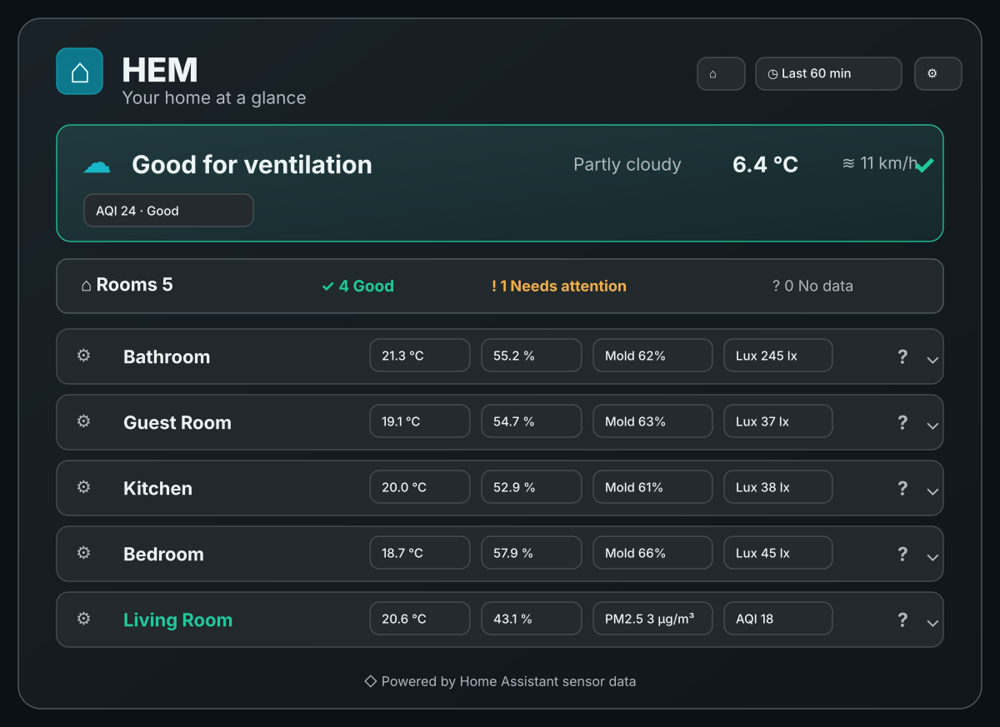
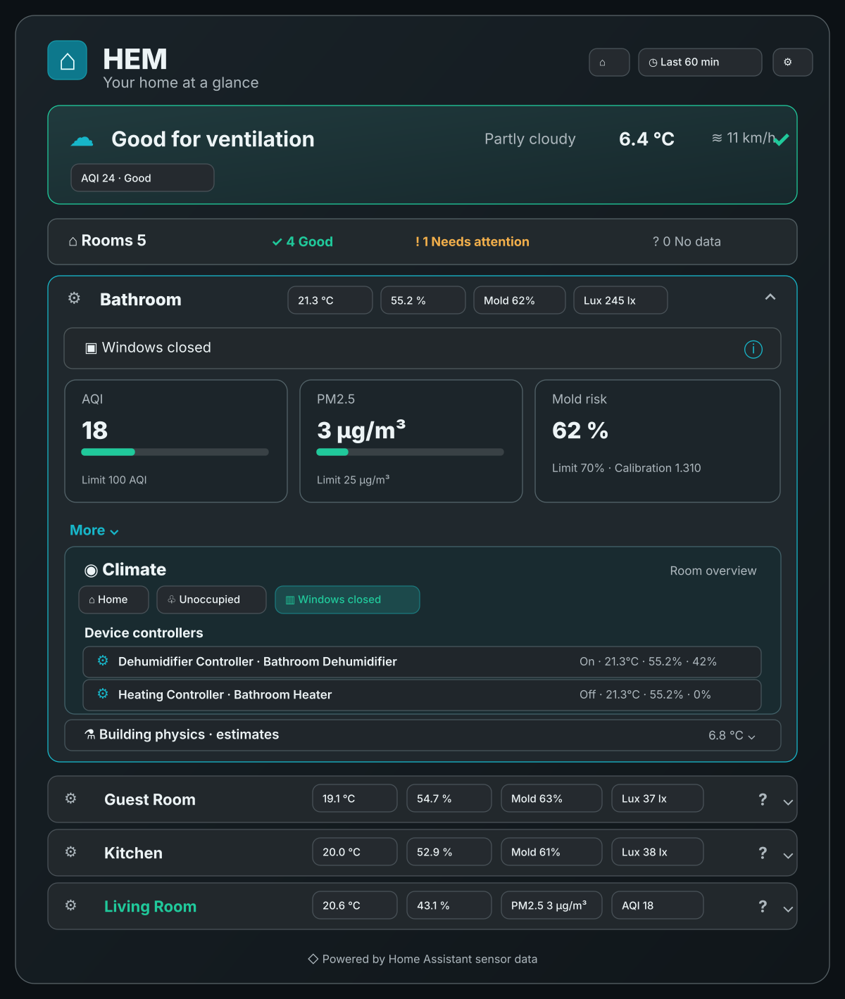
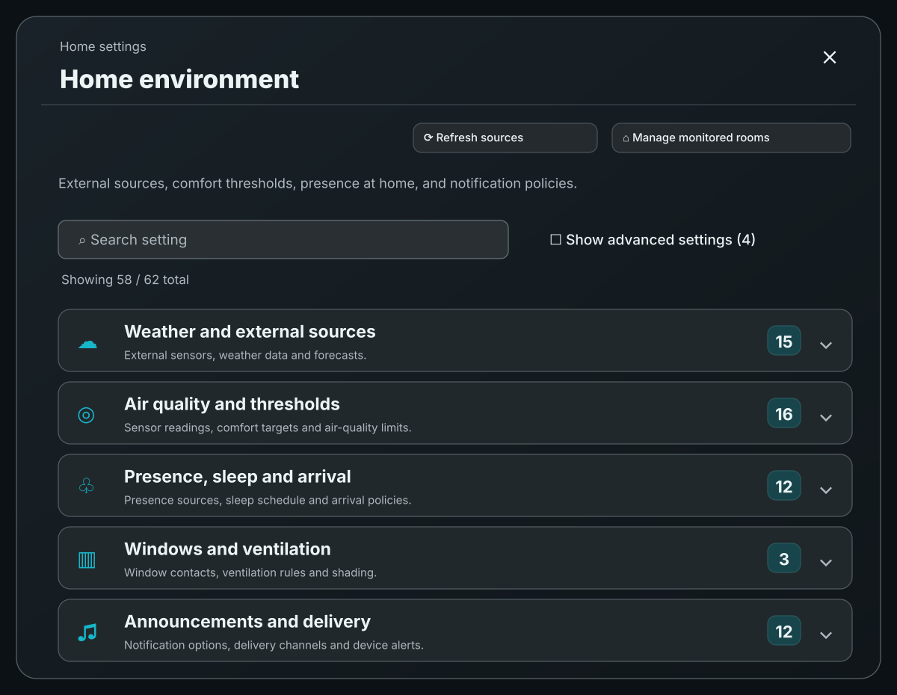
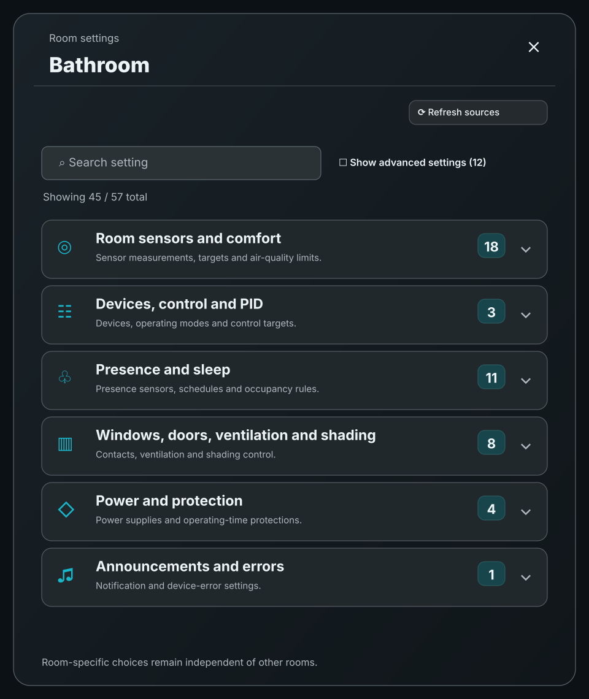
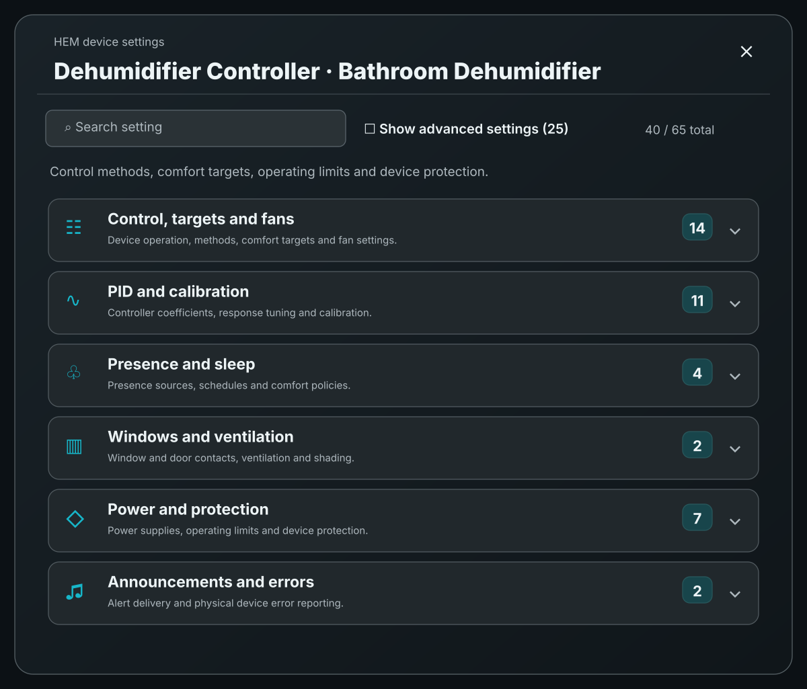

  

  

<!-- HEM-LANGUAGE-SELECTOR-START -->

  <a href="README.ar.md">العربية</a> · <a href="README.bg.md">Български</a> · <a href="README.bn.md">বাংলা</a> · <a href="README.cs.md">Čeština</a> · <a href="README.da.md">Dansk</a> · <a href="README.de.md">Deutsch</a> · <a href="README.el.md">Ελληνικά</a> · <a href="../../README.md">English</a> · <a href="README.es.md">Español</a> · <a href="README.fa.md">فارسی</a> · <a href="README.fi.md">Suomi</a> · <a href="README.fr.md">Français</a> · <a href="README.he.md">עברית</a> · <a href="README.hi.md">हिन्दी</a> · <a href="README.hr.md">Hrvatski</a> · <a href="README.hu.md">Magyar</a> · <a href="README.id.md">Bahasa Indonesia</a> · <a href="README.it.md">Italiano</a> · <a href="README.ja.md">日本語</a> · <a href="README.ko.md">한국어</a> · <a href="README.nb.md">Norsk bokmål</a> · <a href="README.nl.md">Nederlands</a> · <a href="README.pl.md">Polski</a> · <a href="README.pt.md">Português</a> · <strong>Português (Brasil)</strong> · <a href="README.ro.md">Română</a> · <a href="README.ru.md">Русский</a> · <a href="README.sk.md">Slovenčina</a> · <a href="README.sr.md">Српски</a> · <a href="README.sv.md">Svenska</a> · <a href="README.ta.md">தமிழ்</a> · <a href="README.th.md">ไทย</a> · <a href="README.tr.md">Türkçe</a> · <a href="README.uk.md">Українська</a> · <a href="README.ur.md">اردو</a> · <a href="README.vi.md">Tiếng Việt</a> · <a href="README.zh-Hans.md">简体中文</a> · <a href="README.zh-Hant.md">繁體中文</a>

<!-- HEM-LANGUAGE-SELECTOR-END -->

# HEM - Gestor de Ambiente

  

<strong>Todo o ambiente da sua casa, em um Home Assistant Cartão.</strong>

**HEM ajuda a sua casa a entender o seu ambiente e a reagir ao que cada quarto realmente precisa.** Traz-lhe o seu Home Assistant sensores, dados meteorológicos, informações de ocupação e dispositivos climáticos compatíveis juntos, para que possa monitorar a qualidade do ar, receber conselhos de ventilação úteis, gerenciar o conforto e automatizar o equipamento escolhido.

Por exemplo, HEM Pode reduzir o aquecimento enquanto todos estão fora, preparar salas selecionadas antes de voltar, usar um alvo de humidade diferente enquanto dorme ou pedir-lhe para abrir uma janela antes de executar um desumidificador. **monitorar e recomendar**, sem controlar qualquer dispositivo.

**Fica no comando.** Cada sala tem as suas próprias configurações. Cada aparelho suportado tem o seu próprio controlador, modos de operação, alvos e limites de segurança. HEM nunca assume que a selecção de um dispositivo lhe dá permissão para operar esse dispositivo.

[Explore as características](#what-can-hem-do) · [Veja a interface](#see-hem-in-action) · [Instalar HEM](#installation) · [Arranja a tua casa](#getting-started) · [Guia detalhada](../../docs/advanced-configuration.md)

## O que pode HEM - Não?

| A sua situação | Como é que HEM pode ajudar |
| --- | --- |
| **A casa está vazia.** | Passe para alvos de fora, respeite as regras de presença de cada sala e evite executar equipamentos selecionados desnecessariamente. |
| **Estás a caminho de casa.** | Pressão **Preparem-se para a chegada.** para utilizar temporariamente os alvos de conforto doméstico para controladores automáticos elegíveis, mesmo que todos estejam ainda fora. |
| **Alguém está a dormir.** | Use alvos de sono, reduzir o ruído dos ventiladores ou manter os dispositivos escolhidos desligados enquanto todos os quartos ocupados estão dormindo. |
| **Um quarto está úmido .** | Comparar a sua indicação de umidade e molde com os alvos, sugerir ventilação útil, ou operar um desumidificador autorizado usando Automatic ou PID Controle. |
| **Está quente e ensolarado.** | Evaluar a temperatura ambiente, a luz solar, o tempo e os contactos das janelas conectadas antes de mover os tons opt-in. |
| **O ar ao ar parece melhor.** | Recomenda-se a ventilação utilizando a demanda de interiores, a poluição exterior, a temperatura, a humidade, o vento e os avisos de pólen ou meteorológicos disponíveis. |
| **Um aquecedor ou TRV deixa de responder** | Mostre o seu estado de inexistência ou de espera, retém o seu controlador configurado e informe falhas no dispositivo suportado sem assumir que uma bateria ou relevo se recuperaram. |

Estes são exemplos, não acções que HEM Os resultados dependem dos sensores selecionados. Home Assistant capacidades e as suas configurações de opção.

## Explore as características

### Um painel de controle completo em casa

A Comissão HEM O cartão fornece uma visão geral útil sem abrir várias integrações.

- Veja as condições de ar exterior, a qualidade do ar e se é aconselhável ventilar.
- Comparar todas as salas monitoradas num só olhar: temperatura, umidade relativa, AQI, PM2,5, indicação de molde, luz e outras leituras suportadas.
- Expandir qualquer espaço para medições detalhadas, informações sobre janelas e portas, estado climático, controladores ativos, razões de espera e estimativas de física do edifício.
- Veja histórias e tendências, veja quais sensores contribuíram para uma média e distingue as leituras faltantes dos valores medidos.
- Quartos de grupo por número real Home Assistant Se você não tem pisos, use uma simples lista de quartos.

### Diferentes configurações para a casa, cada quarto e cada dispositivo

HEM mantém as políticas partilhadas separadas das decisões locais.

| Nível de configuração | O que você pode configurar |
| --- | --- |
| **Em casa** | Fontes de clima exterior e de poluição, salas monitoradas, limites globais de ventilação, presença doméstica, preparação da chegada e entrega de anúncios. |
| **Quarto** | Fontes de temperatura e de umidade de interior, limiares de qualidade do ar, contatos de janelas e portas, comportamento de sono e ocupação, alvos de conforto específicos para o quarto, opções de ventilação e sombreamento. |
| **Dispositivo individual** | Os modos de controlo disponíveis, Automático/Manual/PID Método, alvos por perfil, sensores, configurações de ventilador silencioso, tempos mínimos de operação, proteções de energia, comportamento das janelas e notificações de erro no dispositivo. |

Os três níveis são acessíveis através de configurações agrupadas e pesquisáveis no cartão. Home Assistant alterações de configuração.

### Controle do clima e PID, dispositivo por dispositivo

HEM pode funcionar com compatível Home Assistant **clima**, **humidificador** e **ventilador** Dispositivos, incluindo aquecimento, arrefecimento, desumidificação, umidificação e equipamentos de circulação de ar ou de limpeza de ar.

Para cada **Modo de funcionamento físico suportado**, escolher o método de controlo de forma independente:

| Método | O que significa |
| --- | --- |
| **Existentes** | Deixar a operação com o caminho do controlador existente. |
| **Automático** | Segue HEMA procura medida, os objectivos e as permissões baseados na situação. |
| **PID** | Utilize o controlo proporcional, integral e derivado baseado em feedback quando o dispositivo e a medição o suportem. |
| **Manual** | Controle através de pedidos e metas explicitamente apoiados. |
| **Desligado .** | Mantenha o controlador desligado, sujeito às exigências de proteção física e feedback. |

Por exemplo, um ar condicionado pode utilizar **PID para aquecimento** e **Automático para arrefecimento**Um desumidificador pode ter o seu próprio PID Os ventiladores elegíveis podem utilizar a PID Quando estiverem disponíveis os dados de retroalimentação adequados e os controlos específicos do objectivo.

PID é **Não** uma sobreposição universal: HEM As opções avançadas incluem sintonização e calibração por modo, ajustes sugeridos / adaptativos, operação silenciosa e configurações de ventilador em fase suportada. Você aprova as alterações sugeridas, a menos que você opte explicitamente por adaptação automática limitada.

### Confortável quando está em casa, econômico quando está fora.

HEM pode escolher entre **Conforto, lar, longe, sono e ecologia** As metas baseadas na situação da família, na evidência da habitação e nas suas escolhas explícitas.

- **Para casa e para fora:** Utilize diferentes metas de aquecimento, resfriamento e umidade dependendo da presença verificada em casa.
- **Presença do quarto:** Execute um dispositivo elegível sempre que houver demanda, apenas enquanto o seu quarto estiver ocupado ou apenas enquanto o quarto estiver vazio.
- **Dormir:** Aplique alvos durante a noite e um comportamento mais silencioso do ventilador.
- **ECO:** Uma porta interior fechada pode participar numa política ecológica protegida quando a sala é verificada vazia e outras condições são cumpridas; uma porta fechada por si só não prova que a sala está isolada.
- **Preparação para o despertar:** Utilize uma fonte de alarme seguinte configurada para deixar automaticamente o Sleep antes do alarme e dar tempo aos dispositivos elegíveis para responder.

Se for incerta a ocupação, a disponibilidade do dispositivo ou outras provas necessárias, HEM não assume simplesmente que é seguro iniciar um dispositivo automático.

### Prepare o seu ambiente antes de chegar

**Preparem-se para a chegada.** É uma ação cronometrada para uma casa de fora confirmada. HEMÉ o dispositivo de casa.

HEM Aplica temporariamente a configuração **Objetivos domésticos** para o Automático elegível/PID controllers para que as salas possam começar a aquecer, resfriar ou ajustar a umidade antes do seu retorno. **somente quando já tiver a permissão necessária de controlo físico**.

A preparação não é um comando para ativar tudo. Os dispositivos ainda precisam de uma demanda genuína, sensores válidos e autorização, e devem respeitar as janelas, tempos mínimos de ligação/desligação e suas próprias proteções. A ação termina quando alguém chega, você cancela ou o temporizador configurado expira. Home Assistant reiniciar não reinicia o tempo completo.

### Conselhos de ventilação, janelas, portas e sombras

HEM comparações **O que uma sala precisa** com **Se o ar exterior pode ajudar**.

- Recomenda-se a abertura ou fechamento de janelas utilizando as medições actuais de interiores, a umidade exterior, a poluição, a temperatura, o vento, os alertas meteorológicos e o contexto opcional do pólen.
- Use os contactos de janelas e portas selecionados para explicar as condições do quarto e evite tratar um contato desconhecido como fechado.
- Opcionalmente, peça-lhe que tente abrir uma janela antes de iniciar um aparelho automático com suporte, e, em seguida, continue com o controle normal após a resposta configurada esperar, se necessário.
- Usar informações de portas para conscientização dos limites da sala, precauções de ventilação e comportamento ecológico protegido opcional.
- Gerenciar obturadores, persianas e sombras optados usando a prova adequada de janela, temperatura, clima, elevação solar e iluminação opcional.

HEM O sistema de ventilação não abre uma janela por si só porque a ventilação ajudaria.

### Umidade, indicação de molde e qualidade do ar

HEM combina leituras suportadas, tais como: **temperatura, umidade, CO2, partículas, COV, AQI e iluminação** As medições disponíveis dependem do que a sua Home Assistant A instalação é provida.

O seu **Indicação de molde** Esta técnica permite estimar as condições de umidade numa superfície fria a partir de temperaturas de ambiente e de ambiente exterior e de uma medição de calibração.

**A indicação de moldes é uma estimativa, não um detector de moldes ou esporas.** Os dados dos sensores faltantes ou obsoletos não podem justificar um novo comando de dispositivo baseado em moldes.

### Anúncios, diagnóstico e protecção

Você pode enviar recomendações e alertas relevantes através de configurações Home Assistant notificações, TTS/produtores de mídia ou **Núcleo de Anúncios**A IA pode alterar a forma como uma mensagem é formulada; HEMAs decisões de controlo físico permanecem deterministas.

HEM Inclui também proteções e diagnósticos específicos do dispositivo:

- Durações mínimas de ligação e desligação, configurações máximas de tempo de operação e manuseio suportado de interruptores de alimentação externos.
- Restrições de janela e ocupação, manuseio manual de reviravoltas e verificações de reconhecimento de comando nativo.
- Relatório de erro e dispositivo indisponível, com uma escolha de comportamento de notificação para cada dispositivo.
- Um vigilante opcional após o fechamento para o aquecimento suspeito de continuar após um comando de desligamento, com monitorização vigilante e tentativas limitadas de recuperação.
- Razões claras de espera, estado operacional atual e disponibilidade de fontes, para que possa investigar antes de permitir mais controle.

**Os limites de segurança permanecem em vigor mesmo quando um alerta é desativado.** HEM nunca trata uma expedição de comando bem-sucedida como prova de que um aparelho respondeu fisicamente.

## Veja . HEM em ação

Estas ilustrações em inglês usam salas de amostras e medições, mostrando a interface em vez de mostrar dados em vivo de uma casa em particular.

### Casa em um olhar

Obter aconselhamento sobre ventilação, condições climáticas e status de cada sala monitorada num único cartão.

  

### Expandir um espaço para detalhes completos

Verificar a qualidade do ar, a indicação do molde, a presença, o estado das janelas, os controladores climáticos e as explicações para cada decisão.

  

### Configurações de casa

Gerenciar fontes ao ar livre, presença em toda a casa, salas monitoradas, limites de ventilação, preparação e notificações.

  

### Configuração do quarto

Escolha o que é importante para cada sala: seus próprios sensores, alvos, ocupação, portas, janelas, ventilação, sombreamento e salvaguardas.

  

### Configurações do dispositivo

Ajustar perfeitamente um dispositivo sem alterar os outros, incluindo os métodos de controlo suportados, PID, operação silenciosa, cronometragem e comunicação de falhas.

  

## Começando

1. **Organizem os seus quartos.** No Home Assistant, criar ou verificar as suas Áreas e atribuir os sensores e dispositivos apropriados a cada uma delas.
2. **Escolha o que monitorar.** Adicionar HEM, selecionar os quartos que lhe interessam e revisar a temperatura, a humidade, a janela, a qualidade do ar e as fontes do dispositivo sugeridos.
3. **Configurar informações compartilhadas.** Selecione as fontes disponíveis de clima ao ar livre/qualidade do ar, evidências de ocupação doméstica e quaisquer destinos de anúncio que deseje.
4. **Adicione o cartão.** Abra um painel de controle em modo de edição e adicione o **Home Gestor de Meio Ambiente** Comece com o monitoramento da sala, leituras e aconselhamento de ventilação.
5. **Habilitar o controlo apenas quando útil.** Abre uma sala, escolha um aparelho suportado, revise o seu controlador e selecione explicitamente Automático ou PID para os modos que você deseja HEM Para operar.

- Sim , sim . **Não** Comece com os sensores que tem, e introduz o controle automático, um dispositivo por vez.

### Adicionar o cartão manualmente

A integração normalmente registra o seu próprio cartão Lovelace.

~~~yaml
type: custom:home-environment-manager-card
~~~

Se o seu Home Assistant instalação tem mais de uma HEM sensores de recomendação, pode ser necessário ajustar o sensor de recomendação **entidade** explícitamente:

~~~yaml
type: custom:home-environment-manager-card
entity: sensor.your_hem_recommendation_sensor
~~~

Para instruções passo a passo sobre as fontes, perfis, PID As informações sobre a aplicação de um sistema de regularização, de configuração, de políticas de janelas, de preparação, de calibração de moldes, de sombreamento solar e de entrega de anúncios [Guia de configuração detalhada](../../docs/advanced-configuration.md).

## Instalação

### HACS / Home Assistant Loja comunitária

1. Abre **HACS** em Home Assistant.
2. Adicionar **O programa de apoio é destinado a ajudar os cidadãos da Grécia e da Grécia.** como um **Repositório personalizado** No **Integração** Categoria se não for já listada.
3. Encontrar **Home Gestor de Meio Ambiente** E instale-o.
4. Reiniciar **Home Assistant** para carregar a integração.
5. Vai para **Configurações → Dispositivos e serviços → Adicionar integração**, busca **Home Gestor de Meio Ambiente** E concluir a configuração.

### Instalação manual

Copiar o repositório **custom_components/environment_manager** na pasta de correspondência **custom_componentes** diretório em seu Home Assistant configuração, mantendo o nome do diretório **ambiente_manager**Reiniciar . Home Assistant e adicionar a integração através de **Configurações → Dispositivos e serviços**.

Para mudanças de instalação subsequentes, mantenha as instalações existentes HEM inserção e configurações de integração. Recarregar o painel do navegador se a aparência do cartão não se atualizar imediatamente.

## Questões comuns

**Posso usar HEM Sem dar-lhe o controlo dos meus dispositivos?**

Sim. Monitoramento, medições, aconselhamento de ventilação, histórico e muitas indicações ambientais funcionam sem permitir a ativação do dispositivo.

**Will, não. HEM Controlar automaticamente cada dispositivo que descobre?**

Não. Você seleciona os dispositivos físicos que deseja gerenciar e escolhe explicitamente o método de controle para os modos suportados.

**Todos os aparelhos PID?**

- Não, não, não. HEM Auxílios PID para **elegíveis** rotas de aquecimento, arrefecimento, umidade ou controlo do ventilador, quando o aparelho e as medidas selecionadas fornecem as capacidades e os dados de retroalimentação necessários. PID Controle.

**Posso dar regras diferentes a cada quarto?**

Sim. As condições de ocupação, o comportamento do sono, as fontes, os alvos e algumas preferências de segurança podem diferir de acordo com a sala, enquanto cada dispositivo físico tem suas próprias configurações de operação e proteção.

**Pode ser HEM Preparar a minha casa enquanto estiver fora?**

- Sim, sim, sim. **Preparem-se para a chegada.** O sistema permite que controladores automáticos elegíveis, já autorizados, utilizem os alvos domésticos por um período limitado, não contornando as proteções físicas nem garantindo que um alvo será atingido.

**Uma recomendação para ventilação abre as minhas janelas?**

Não. Explica quando a ventilação pode ajudar. O movimento automático é uma característica separada, opt-in para os tons ou coberturas com suporte elegíveis, sujeitos a seus próprios controles de segurança.

**E se um sensor ou um dispositivo não estiver disponível?**

HEM O controlo automático continua a exigir uma autoridade e uma evidência válidas.

## Ajuda e solução de problemas

Se algo parecer errado, verifique a sala relevante ou o controlador **Razão**, **Diagnóstico**, disponibilidade da fonte e método de controlo corrente. [Guia de configuração detalhada](../../docs/advanced-configuration.md) abrange os estados de espera comuns, as políticas de presença, PID Eligibilidade, janelas e solução de problemas de resposta do dispositivo.

Para um problema reprodutível, [abrindo um GitHub Emissão](https://github.com/Chreece/HA-Home-Environment-Manager/issues) Com o comportamento esperado, o comportamento real, as configurações de sala/dispositivo relevantes e as etapas para reproduzir.

As contribuições e melhorias são bem-vindas. [Contribuição.md](../../CONTRIBUTING.md).

## Apoio e licença

Se HEM É útil para você, você pode [Apoio à Grécia no Ko-fi](https://ko-fi.com/chreece).

Distribuído sob a [Licença do MIT](../../LICENSE).
