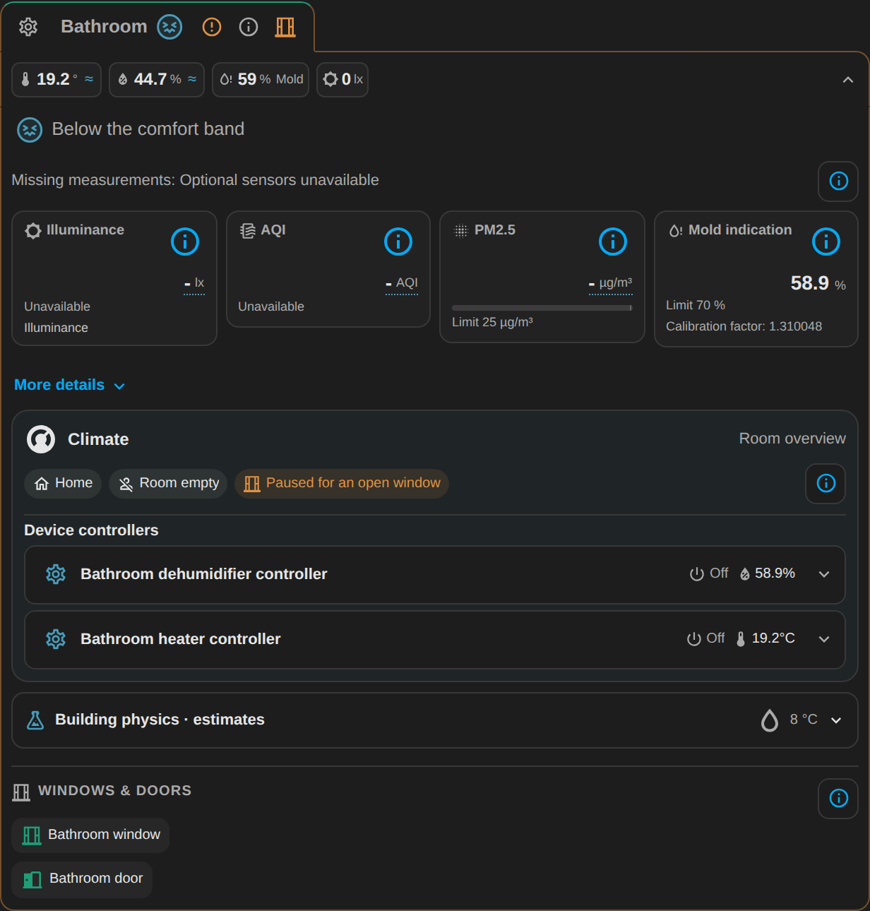

  

  

<!-- HEM-LANGUAGE-SELECTOR-START -->

  <a href="README.ar.md">العربية</a> · <a href="README.bg.md">Български</a> · <a href="README.bn.md">বাংলা</a> · <a href="README.cs.md">Čeština</a> · <a href="README.da.md">Dansk</a> · <a href="README.de.md">Deutsch</a> · <a href="README.el.md">Ελληνικά</a> · <a href="../../README.md">English</a> · <a href="README.es.md">Español</a> · <a href="README.fa.md">فارسی</a> · <a href="README.fi.md">Suomi</a> · <a href="README.fr.md">Français</a> · <a href="README.he.md">עברית</a> · <a href="README.hi.md">हिन्दी</a> · <a href="README.hr.md">Hrvatski</a> · <a href="README.hu.md">Magyar</a> · <a href="README.id.md">Bahasa Indonesia</a> · <a href="README.it.md">Italiano</a> · <a href="README.ja.md">日本語</a> · <a href="README.ko.md">한국어</a> · <a href="README.nb.md">Norsk bokmål</a> · <a href="README.nl.md">Nederlands</a> · <a href="README.pl.md">Polski</a> · <a href="README.pt.md">Português</a> · <a href="README.pt-BR.md">Português (Brasil)</a> · <a href="README.ro.md">Română</a> · <a href="README.ru.md">Русский</a> · <a href="README.sk.md">Slovenčina</a> · <strong>Српски</strong> · <a href="README.sv.md">Svenska</a> · <a href="README.ta.md">தமிழ்</a> · <a href="README.th.md">ไทย</a> · <a href="README.tr.md">Türkçe</a> · <a href="README.uk.md">Українська</a> · <a href="README.ur.md">اردو</a> · <a href="README.vi.md">Tiếng Việt</a> · <a href="README.zh-Hans.md">简体中文</a> · <a href="README.zh-Hant.md">繁體中文</a>

<!-- HEM-LANGUAGE-SELECTOR-END -->

# HEM - Home Environment Manager

<!-- HEM-TRANSLATION-UNREVIEWED-START -->
> ⚠️ **Непроверен машински превод.** Језичка и техничка тачност ове странице није проверена и неки описи могу бити погрешни. Упутства за инсталацију, управљање уређајима и безбедност погледајте у <a href="../../README.md">README датотеци на енглеском</a>.
<!-- HEM-TRANSLATION-UNREVIEWED-END -->

  

<strong>Цела околина вашег дома, у једној Home Assistant Карту.</strong>

[Примери по просторијама](#what-can-hem-do) · [Могућности](#explore-the-features) · [Снимци екрана](#see-hem-in-action) · [Инсталација](#installation) · [Први кораци](#getting-started) · [Честа питања](#common-questions) · [Решавање проблема](#help-and-troubleshooting) · [Подршка и лиценца](#support-and-license)

## Укратко

HEM користи сензоре које већ имате у систему Home Assistant и за сваку просторију приказује температуру, влажност и квалитет ваздуха. Пореди услове унутра и напољу и предлаже када да отворите или затворите прозоре. Можете користити само савете или му препустити управљање изабраним грејалицама, клима-уређајима, вентилаторима и одвлаживачима, са различитим циљним вредностима када сте код куће, одсутни или спавате.

  

[Детални водич](../../docs/advanced-configuration.md) · [Сва подешавања (на енглеском)](../../docs/settings-reference.md)

## Шта може HEM да ли?

| Твоја ситуација | Како је то било? HEM може помоћи |
| --- | --- |
| **Кућа је празна.** | Промињете се на "Избаците" циљеве, поштујте правила присуства сваке собе и избегавајте непотребно покретање одабране опреме. |
| **На путу си кући.** | Преси **Припремите се за долазак.** да привремено користе циљеве за кућну удобност за квалификоване аутоматске контролере, иако су сви још увек далеко. |
| **Неко спава.** | Употребите циљеве за спавање, смањите буку од љубитеља или искључите изабране уређаје док свако заузета соба спи. |
| **Једна соба је влажна.** | Спробајте његову индикацију влажности и плесенице са циљевима, предложите корисне ваздушнице или управљајте овлашћеним одвлачивачем користећи аутоматски или PID контролу. |
| **То је топло и сунчево.** | Пре него што преузмете изабране нијансе, процените просторију, сунце, време и повезане контактне прозоре. |
| **Вонски ваздух изгледа боље.** | Препоручује се вентилација користећи захтев за унутрашњост, загађење на отвореном, температуру, влагу, ветар и доступне упозорења о пољуби или временским условима. |
| **Огревач или ТРВ престаје да реагује** | Показати стање недоступности или чекања, задржати конфигуриран контролер и пријавити оштећења подржаног уређаја без претпоставке да се батерија или реле опоравио. |

Ово су примери, а не акције које HEM Резултати зависе од изабраних сензора, стварне вредности сваког уређаја. Home Assistant могућности и подешавања за улазак.

## Истражите карактеристике

### Комплетна кућна табла

Именовање HEM карта вам даје користан преглед без отварања неколико интеграција.

- Погледајте услове на отвореном, квалитет ваздуха и да ли је препоручено вентилацију.
- Спробајте све мониториране просторије на један поглед: температуру, релативну влагу, АКИ, ПМ2.5, индикацију плеса, светлост и друге подржане читања.
- Поширите било коју простору за детаљне мерења, информације о прозорима и вратима, статусу климе, активним контролерима, разлозима чекања и проценама физике зграде.
- Погледајте историју и трендове, погледајте који сензори су допринели просеку и разликујте недостајуће читања од мерених вредности.
- Групне просторије по реалним Home Assistant или користите једноставну листу соба када немате подове.

### Различне подешавања за дом, сваки простор и сваки уређај

HEM одржава заједничке политике одвојене од локалних одлука.

| Ниво подешавања | Шта можете конфигурисати |
| --- | --- |
| **Дома** | Изворне погоде и извори загађења, контролисане просторије, глобалне границе вентилације, присуство домаћинства, припрема за долазак и испорука обавештења. |
| **Соба** | Извори температуре и влажности у унутрашњости, прагови квалитета ваздуха, контакти прозора и врата, понашање у спавању и заузимању, цели за удобност специфичне за просторије, избор вентилације и сенчања. |
| **Индивидуални уређај** | Његови доступни режими управљања, аутоматски/ручни/PID Метод, циљеви по профилу, сензори, подешавања тихог љубитеља, минимални оперативни времена, заштите снаге, понашање прозора и обавештења о грешки у уређају. |

Подешавања дома, просторија и уређаја груписана су на картици и могу се претраживати. Изаберите **Основно**, **Напредно** или **Стручно** да одредите која се подешавања приказују. Основно обухвата свакодневне контроле и неопходно подешавање. Напредно додаје ручно подешавање PID коефицијената и детаљне измене. Стручно додаје специјализоване моделе и подешавање капацитета. Сваки ниво обухвата претходне. Доступне изворе можете освежити када се промени ваша Home Assistant инсталација. <!-- HEM-I18N:levels -->

### Контрола климе и PID, уређај по уређају

HEM може радити са компатибилним Home Assistant **клима**, **увлаживач** и **фан** уређаји, укључујући опрему за грејање, хлађење, дехумидификацију, увлаживање и подршку за циркулацију ваздуха или чишћење ваздуха.

За сваку **подржани физички режим рада**, изабрати контролни метод независно:

| Метода | Шта то значи |
| --- | --- |
| **Постојећи** | Оставите операцију са постојећим путом контролера. |
| **Автоматски** | Следи HEMИзмерене захтеве, циљеви засновани на ситуацији и дозволе. |
| **PID** | Употребите пропорционалну, интегралну и производну контролу засновану на повратној информации где га уређај и мерење подржавају. |
| **Упутник** | Контрола путем експлицитних поддржаних захтева и циљева. |
| **Излаз.** | Држите тај контролер искључен, под обзиром на физичку заштиту и захтеве повратне информације. |

На пример, један климатичар може користити **PID за грејање** и **Автоматски за хлађење**Деумодификатор може имати свој PID калибровање, циљеве и време циклуса. PID када су на располагању одговарајућа повратна информација и специфична контрола за сврху.

PID је **Не, није** универзална превазилазак: HEM Предлаже се само методе које одређени уређај, режим операције и извор повратне информације могу подржати. напредне опције укључују подешавање и калибрацију по режиму, предложене / адаптивне прилагођавања, тихну операцију и подржане подешавања фана.

### Удобна када си код куће, економска када си далеко

HEM може изабрати између **Удобност, кућа, одлазак, спавање и екологија** Циљеви засновани на ситуацији домаћинства, доказама простора и вашим експлицитним изборима.

- **Дома и далеко:** Користе различите циљеве за грејање, хлађење и влагу у зависности од потврђеног присуства дома.
- **Присуство у соби:** Поправљајте одговарајуће уређај увек када постоји потражња, само док је соба заузета, или само док је соба празна.
- **Спавање:** Избрани уређај може остати искључен када све заузете собе спавају.
- **Еко:** Користите економске циљеве када су конфигуриране. Затворено унутрашње врата може да учествује у заштићеним Еко политике када се провери да је соба празна и да су испуњени други услови; само затворено врата не доказује да је соба изолована.
- **Припрема за буђење:** Користите конфигуриран извор следећег аларма како бисте оставили аутоматски СЛП пре аларма и дали одговарајућим уређајима време да реагују.

Уколико је запошљавање, доступност уређаја или други потребни докази нејасни, HEM не претпоставља једноставно да је безбедно покретати аутоматски уређај.

### Припремите своје окружење пре доласка

**Припремите се за долазак.** је распоређена акција за потврђену кућу. HEMДомашњи уређај.

HEM привремено примењује конфигуриран **Домашње циљеве** до прихватљивих аутоматских/PID контролере тако да се просторије могу почети грејати, хладити или прилагодити влагу пре повратака. **само када већ има потребну дозволу за физичку контролу**.

Припрема није команда да се све укључи. Уредима још увек треба стварна потрага, важећи сензори и овлашћења, и морају поштовати прозорце, минимални времена за укључивање и искључивање и сопствене заштите. Акција се завршава када неко дође, анулирате га или конфигуриран тајмер истека. Home Assistant рестарт не покреће пуну таймеру.

### Консультације о вентилацији, прозорима, вратима и сенковању

HEM упоређивање **шта је потребна соба** са **да ли ваздух на отвореном може помоћи**.

- Препоручује се отварање или затварање прозора користећи тренутне мерења унутрашњег простора, влажност на отвореном, загађење, температуру, ветар, сигнале за временску ситуацију и опционални контекст пollen.
- Индекс AQI није обавезан. Ако скала добављача није подешена, HEM пријављује непотпуне податке; то само по себи не спречава проветравање и није разлог за затварање прозора. Ваљана мерења загађујућих материја и заиста опасне вредности AQI-ја, протумачене према исправној скали, и даље се узимају у обзир. <!-- HEM-I18N:aqi -->
- Користите одабране контактне прозоре и врата да бисте објаснили услове просторије и избегли третирање непознатог контакта као затворено.
- Балконска или терасна врата са класом бинарног сензора Home Assistant `door` или `opening` можете по жељи укључити као **улазе за прозоре**. Појављују се у избору прозора просторије, али **никада нису унапред изабрана**. Уобичајени надзор врата остаје независан. <!-- HEM-I18N:balcony -->
- Опционално вас замоли да покушате да отворите прозор пре покретања подржаног аутоматског уређаја, а затим наставите нормалну контролу након што је конфигуриран одговор чека ако је потребно.
- Користе информације о вратима за свест о границама просторије, упозорења о вентилацији и изборно чување еко понашања.
- Управљајте опционим затварачима, презервативама и сенцима користећи одговарајуће прозоре, температуру, време, излазак сунца и опционалне свеће доказа.

HEM Не може да се отвори прозор само зато што би му помагало да се вентилише.

### Увлажност, индикација плеса и квалитет ваздуха

HEM комбинује подржане читања као што су **температура, влажност, CO2, честице, VOC, AQI и осветљење** Доступна мерења зависе од тога шта је потребно за вас. Home Assistant обезбеђује поставку.

Његова **индикација плеса** процењује услове влажности на хладној површини из просторије и старије температуре и калибрираног мерења.

**Индикација плеса је процена, а не детектор плеса или спора.** Недостатак или застарели подаци сензора не могу оправдати нову команду уређаја на основу форме.

### Уведомљења, дијагностика и заштита

Можете послати релевантне препоруке и упозорења преко конфигурисаних Home Assistant обавештења, ТТС/медија плејери или **Хаб оглашавања**ИИ може променити фразирање поруке; HEMОдлуке физичке контроле остају детерминистичке.

HEM такође укључује заштиту и дијагностику специфичну за уређај:

- Минимални трајања укључености и искључености, максималне подешавања времена рада и поддржавање управљања спољним прекидачима снаге.
- Ограничења прозора и заузимања, ручно управљање преведом и проверка потврде локалне команде.
- Извештај о грешкама и недоступним уређајима, са избором понашања обавештења за сваки уређај.
- За сваки уређај можете пратити да ли се грејање, хлађење, одвлаживање или овлаживање наставља након искључивања. Изаберите само праћење или дозволите до две додатне команде за искључивање.
- Јасни разлози чекања, тренутни оперативни статус и доступност извора, тако да можете истражити пре омогућити више контроле.

**Ограничења безбедности остају на снази чак и када је упозорење онемогућено.** HEM никада не третира успјешно командно испраће као доказ да је уређај физички реаговао.

## Видите ли HEM у акцији

Ове илустрације на енглеском језику користе узоре просторија и мерења.

### Дом у једном погледу

Добијте савете о вентилацији, временским условима и статусу сваке контролисане собе на једној картици.

  

### Поширите простор за све детаље

Проверите квалитет ваздуха, индикацију плеће, присуство, стање прозора, контролере климе и објашњења за сваку одлуку.

  

### Домашња подешавања

Управљајте изворама на отвореном, присуством у целом дому, надгледаним просторијама, границама вентилације, припремом и обавештењима.

  

### Улога у просторији

Изаберете оно што је важно за сваку собу: своје сензоре, циљеве, заузимање, врата, прозоре, вентилацију, сенку и заштитне мере.

  

### Постављања уређаја

Финална подешавање једног уређаја без промене других, укључујући поддржане методе контроле, PID, тихо функционисање, време и пријаве грешака.

  

## Почнући

1. **Организујте своје собе.** У Home Assistant, креирајте или проверите своје области и доделите одговарајуће сензоре и уређаје свакој од њих.
2. **Изаберите шта да пратите.** Додавање HEM, изаберете просторије које вам је важно и прегледајте предложене температуре, влажности, прозора, квалитета ваздуха и извора уређаја.
3. **Конфигурирајте заједничку информацију.** Изаберете доступне изворе за погоду на отвореном/качест ваздуха, доказ за заузимање домаћинства и било које одредице за оглашавање које желите.
4. **Home Environment Manager** Отворите тачборд у режиму редактирања и додајте **Домашњи менаџер за животну средину** Почни са следењем просторије, читањем и саветом о вентилацији.
5. **Омогући контролу само када је корисно.** Отвори соба, изабери подржану уређај, прегледај њен контролер и изрично изабери Автоматски или PID за режиме које желите HEM да ради.

Ти јеш. **Не, није** Почните са сензорима који имате, и уведите аутоматску контролу један уређај одједном.

### Додајте карту ручно

Интеграција обично региструје сопствену картицу Ловелас.

~~~yaml
type: custom:home-environment-manager-card
~~~

Ако је ваш Home Assistant инсталација има више од једне HEM Стензор препоруке, можда ћете морати да подесите одговарајући **субјекти** експлицитно:

~~~yaml
type: custom:home-environment-manager-card
entity: sensor.your_hem_recommendation_sensor
~~~

Упутства за кретање по крећу о изворима соба, профилима, PID Уреди, политика прозора, припрема, калибровање плеса, сунчево сенковање и испорука обавештења, користите [детаљни водич конфигурације](../../docs/advanced-configuration.md).

## Инсталација

### HACS / Home Assistant Магазин у заједници

1. Отворени **HACS** у Home Assistant.
2. Додавање **https://github.com/Chreece/HA-Home-Environment-Manager** као **прилагођени складиште** у **Интеграција** категорија ако није већ наведена на листи.
3. Нађите **Home Environment Manager** и инсталирајте га.
4. Поново покретање **Home Assistant** да загрупи интеграцију.
5. Иди у **Накладе → Уреди и услуге → Додавање интеграције**, тражење за **Home Environment Manager** И завршити поставку.

### Ручна инсталација

Копирање складишта **custom_components/environment_manager** папка у одговарајућу **custom_components** директорију у вашем Home Assistant конфигурација, задржавање имена директорије **environment_manager**Поново започети. Home Assistant и додати интеграцију кроз **Настройке → Устройства и услуге**.

За следеће промене у инсталацији, чувајте постојеће HEM Интеграција и подешавања. Презагруђивајте тачборд у прегледачу ако изглед картице не освежи одмах.

## Често постављена питања

**Могу ли користити? HEM Без да му дајем контролу над мојим уређајима?**

Да. Мониторинг, мерења, саветовања за вентилацију, историја и многе индикације животне средине раде без да се омогући покретање уређаја.

**Уилл HEM аутоматски контролише сваки уређај који открије?**

Не. Изаберете физичке уређаје које желите да управљате и експлицитно изаберете методу контроле за подржане режиме.

**Да ли сваки уређај подржава PID?**

Не, не, не, не. HEM подршка PID за **допустима** нагревање, хлађење, влажност или контролна стаза вентилатора када уређај и изабрани мерења обезбеде потребне могућности и повратне информације. PID контролу.

**Могу ли дати свакој соби различите правила?**

Да, услови за заузимање, понашање у сну, извори, циљеви и неке безбедносне преференције могу се разликовати по просторијама, док сваки физички уређај има своје подешавања за рад и заштиту.

**Може HEM припреми мој дом док сам далеко?**

Да, ја сам. **Припремите се за долазак.** То не обмиње физичку заштиту и не гарантује постизање циља.

**Да ли препорука за добро вентилацију отвара моје прозоре?**

Не. Он објашњава када ваздух може помоћи. Автоматско кретање је посебна опција за прихватљиве подржане нијансе или покривке, подвргнута сопственим безбедносним проверима.

**Шта ако сензор или уређај не буде доступан?**

HEM разликује непознате податке од стварних читања, задржава конфигуриране информације контролера када је то могуће и открива разлоге чекања и дијагностику.

## Помоћ и решавање проблема

Ако се нешто чини погрешно, проверите одговарајућу собу или контролер **Разлог**, **Дијагностике**, доступност извора и метода стручне контроле. [детаљни водич конфигурације](../../docs/advanced-configuration.md) покрива заједничке државе чекања, политику присуства, PID Угласност, окна и решавање проблема у одговору уређаја.

За репродукбилан проблем, [отворити GitHub издање](https://github.com/Chreece/HA-Home-Environment-Manager/issues) са очекиваним понашањем, стварним понашањем, релевантним подешавањем простора/уредица и корацима за репродукцију.

Доноси и побољшања су добредошливе. [КОНТРУБУТИНГ.мД](../../CONTRIBUTING.md).

## Поддршка и лиценца

Ако је HEM је корисно за вас, можете [подршка Крицу на Ко-фи-у](https://ko-fi.com/chreece).

Разподаје се у складу са [Лицензија МИТ-а](../../LICENSE).
